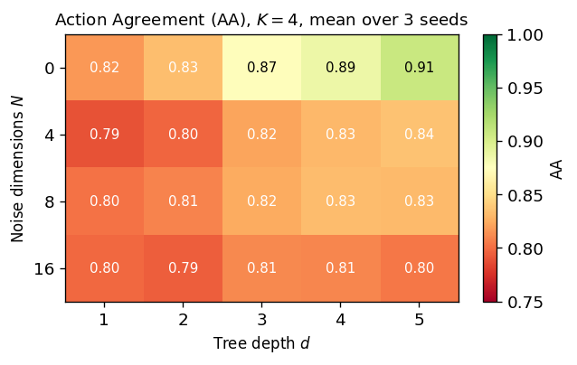
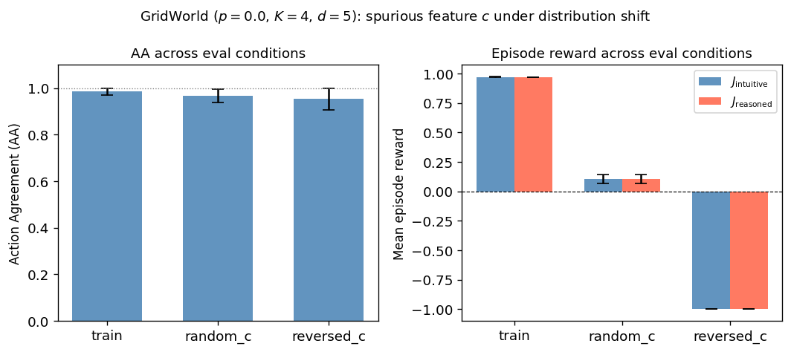
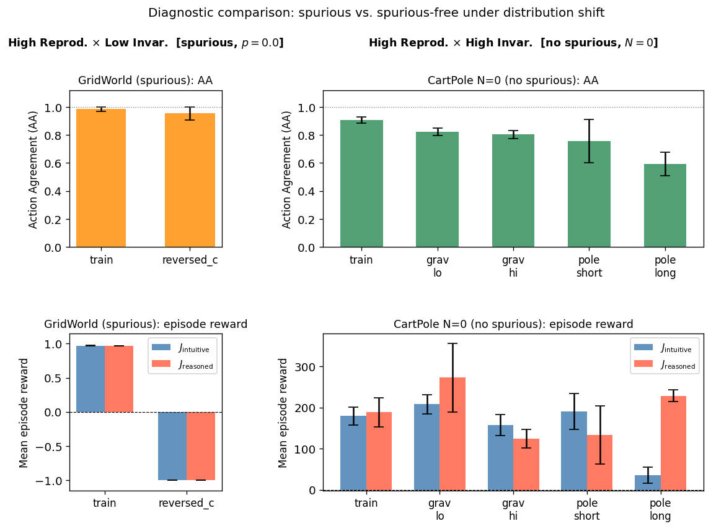
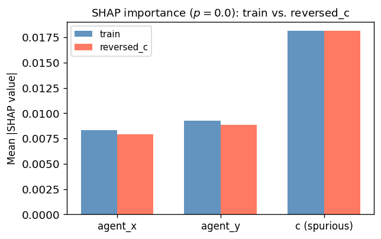
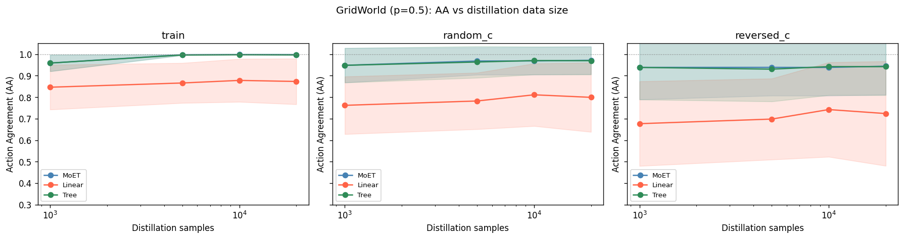

# 構造制約ボトルネックに基づく強化学習方策の説明可能性評価枠組み

## 要旨

強化学習で学習したブラックボックス方策（Oracle policy）に手を加えず、構造制約付きの蒸留モデル（Surrogate model）を事後的に配置する**分離（decoupling）**により、説明可能性と性能のトレードオフを回避する枠組みを提案する。本研究の中心的主張は三点に集約される。第一に、Surrogate model の行動一致率（AA）が高いことは説明候補となるための**必要条件**に過ぎない。第二に、分布シフト下での不変性を追加の評価軸として用いることで、「高 AA だが誤っている」状態を識別できる。第三に、再現性と不変性の二軸評価は Surrogate model の内部構造を問わないため、任意の解釈可能モデルを共通の土台で比較できる。CartPole 拡張環境とスプリアス GridWorld を用いた実験により、スプリアス依存を複製した Surrogate model が訓練分布では高 AA を示しながら分布シフト下で崩壊するケースと、スプリアスのない環境で AA が相対的に保たれるケースを実験的に示す。

## 1. 序論

説明可能なモデルは性能が低く、高性能なモデルは解釈しにくいというトレードオフは XAI の根本的制約として長く指摘されてきた。決定木や線形モデルは構造が読みやすい一方で強化学習のような逐次意思決定では性能が大きく劣り、LIME[^8] や SHAP[^4] のような事後的説明手法は元のモデルに手を加えないが、元の方策の振る舞いをどれだけ忠実に捉えているかは自明でない（Chen et al., 2022[^1]）。説明を対話的・共同構成的なプロセスとして捉える近年の研究（Mindlin et al., 2025[^2]）は、静的な説明の限界を浮き彫りにしている。先行研究との詳細な関係は Section 2 で整理する。

本研究はこのトレードオフを**分離（decoupling）**によって回避する。強化学習で学習した高性能な方策（Oracle policy）には一切手を加えず、その横に構造制約付きの蒸留モデル（Surrogate model）を事後的に配置する。性能は Oracle policy が担い、説明の構造的な候補は Surrogate model が担う。各用語の厳密な定義は Section 3 で与える。

しかし、Surrogate model が高い AA で Oracle policy を模倣できたとして、その説明を信頼してよいか。方策蒸留の先行研究（Bastani et al., 2018[^6]; Vasic et al., 2019[^3]）は AA の最大化をゴールとしてきたが、高 AA の代理モデルが元の方策と同じスプリアス依存を写し取っている場合を検出する仕組みを持たない。RL では方策の行動選択が次の状態遷移を規定し、一つの誤りが後続の行動列全体を崩壊させうるため、スプリアス依存を忠実に再現した Surrogate model は分布シフト下で壊滅的に失敗する。本研究は、説明可能性を**再現性**（訓練分布上での行動一致）と**分布シフト下での不変性**（シフト後の AA と方策性能の維持）の両面から診断する枠組みを提案する。本研究の貢献は以下の三点にある。

1. 説明可能性と性能のトレードオフを分離によって回避し、Oracle policy の性能を損なわずに任意の Surrogate model の説明品質を事後的に評価する枠組みを提案する。Surrogate model の内部構造を問わないため、決定木・MoET・線形モデルをはじめ将来の解釈可能モデルも共通の評価軸で横断比較できる。
2. 再現性（AA）と不変性（分布シフト下の AA・$J_S$）を組み合わせた二段階評価方法論を提供し、「高 AA だが誤っている」状態を数値から識別できることを実験的に示す（実験 2 が直接的証拠、実験 3 が対照的証拠）。
3. CartPole とスプリアス GridWorld を用いた実験で、構造制約の強さ・入力分布・依存構造に応じて再現性と不変性がどう変化するかを示し、複数の RL 環境で一貫した評価軸として機能する傾向を示す。さらに、LunarLander-v3 および MuJoCo Hopper-v5 を用いた検証により、連続物理系への本枠組みの適用可能性を示す（実験 7・8；付録4・5）。

## 2. 関連研究

### 2.1 方策蒸留と代理モデル

ブラックボックス方策を解釈可能なモデルで近似する研究は方策蒸留の文脈で進められてきた。Vasic ら（2019）の MoET は、ニューラルネットワーク方策をソフトゲーティング付きの決定木混合モデルに蒸留し、解釈可能性と精度を両立する。Bastani ら（2018）[^6]の決定木蒸留や線形モデルによる近似（Kolter & Ng, 2009[^7]）も同様に、方策の行動を保存しながら構造的な単純さを実現することを目標とする。これらの研究は AA の最大化を達成の証拠とするが、高 AA の代理モデルが元の方策と同じスプリアス依存を写し取っている場合を検出する仕組みを持たない。本研究はこの欠落を不変性の評価で補う。

### 2.2 事後的説明手法と Faithfulness

LIME（Ribeiro et al., 2016[^8]）と SHAP（Lundberg & Lee, 2017[^4]）は個々の予測に対する局所的な特徴寄与を算出する手法として広く用いられる。これらの手法は「方策が現在どの特徴に依存しているか」を示すが、その依存が分布変化に対して有効かどうかを問わない。Faithfulness に関する研究（Alvarez-Melis & Jaakkola, 2018[^9]; Samek et al., 2017[^10]）は訓練分布内での説明の忠実性を評価しようとするが、訓練分布外での忠実性維持は問われない。本研究の不変性の概念は、分布外での faithfulness の維持を直接評価する点でこれらを補完する。

### 2.3 不変性と分布シフトの解釈可能性

IRM（Arjovsky et al., 2019[^5]）は複数環境で一貫して有効な特徴表現を学習することでスプリアス相関への依存を回避しようとする学習戦略である。概念ボトルネックモデル（Koh et al., 2020[^11]）は人間が定義した概念を中間表現として用い、説明の因果的な意味を高める。事後的概念ボトルネックモデル（Yuksekgonul et al., 2023[^13]）はこれを再学習なしに任意の学習済みモデルへ適用可能にし、事後評価という立場を共有する点で本研究と方向性が近い。これらが解釈可能な表現を付与することを目的とするのに対し、本研究は学習済み方策について依存がスプリアスかどうかを事後的に測定する枠組みを提供する点で異なる。

なお、分布シフト下でのモデル評価という操作は OOD ロバスト性研究（Gulrajani & Lopez-Paz, 2021[^15]; Sagawa et al., 2020[^16]）でも用いられるが、目的が根本的に異なる。OOD ロバスト性研究はシフト後の性能向上を目指す訓練戦略を問う。本枠組みは訓練戦略を変えるものではなく、分布シフトを既存の蒸留済み Surrogate model の説明品質を診断するための事後的ツールとして用いる。目的はロバスト性の実現ではなく、任意の解釈可能モデルに対して共通の評価軸を提供する評価方法論の確立にある。

### 2.4 RL における説明可能性

強化学習の文脈では、注意機構の可視化（Greydanus et al., 2018[^12]）などの手法が提案されてきた。Puiutta & Veith（2020）[^17]は RL の説明可能性研究を包括的にサーベイし、説明の対象と形式の多様性を整理している。本研究はこれらの手法と直接競合するものではなく、「生成した説明が方策の行動を本当に捉えているか」という横断的な問いに答える評価軸として位置づけられる。

## 3. 背景と定義

### 3.1 方策

状態空間 $\mathcal{S}$、行動空間 $A$ に対し、確率的方策を $\pi_O(a \mid s)$ と表す。$\pi_O$ を **Oracle policy** と呼び、強化学習で学習されたブラックボックス方策で、内部表現の意味付けを与えない。

### 3.2 構造制約付きモデル

**Surrogate model** は $\pi_O$ を模倣する構造制約付きモデルである。状態 $s$ を制約された中間表現 $z \in Z$ に写像する関数 $\phi$ と、行動分布を出力する関数 $D$ により、

$$z = \phi(s), \qquad \pi_S(a \mid s) = D(\phi(s))$$

と書ける。$Z$ は低次元・単純・解釈可能な表現空間であり、具体例として線形モデル、深さ制限付き決定木、MoET（Vasic et al., 2019[^3]）が挙げられる。本枠組みは $\pi_S$ の具体的な実装を問わない。決定木・MoET・線形モデルのいずれを選んでも、あるいは将来登場する新たな解釈可能モデルを採用しても、再現性と不変性という同一の評価軸で比較できる。本研究では Surrogate model を、方策の振る舞いの保存可能性を測る構造ボトルネックの同定ツールとして位置づける。

### 3.3 説明可能性の評価枠組み

本研究では Surrogate model による説明の質を二段階で評価する。

**第一段階：再現性の確認。** Surrogate model が $\pi_O$ の行動を訓練分布上で十分に再現できなければ、そのモデルは方策の近似としてそもそも成立しない。離散行動空間では行動一致率（AA）、連続行動空間では決定係数（$R^2$）または $\varepsilon$-agreement（特定の誤差範囲内への収束率）を指標として用いる。これらが高いことは、意味のある説明候補となるための**必要条件**である。実証的な目安として、AA > 0.9 または $R^2 > 0.9$ を高再現性の基準として用いる。ただし、極端な物理パラメータシフトではこれらの指標が低下する場合があり、この閾値はすべての条件で普遍的に達成されることを意味しない。

**第二段階：不変性の検査。** 高 AA を達成した Surrogate model であっても、スプリアス依存を含む方策から蒸留された場合、その依存構造ごと写し取り、訓練分布では高 AA を示しながら分布シフト下で崩壊する。分布シフト $D_\text{train} \to D_\text{shift}$ に対し、$({\rm AA}(D_\text{shift}),\; J_S(D_\text{shift}))$ の組を不変性の評価指標として報告する。

不変性の診断は以下の判定基準に基づく。スプリアス依存の疑いが強い場合とは、${\rm AA}(D_\text{shift}) > \theta_{\rm AA}$ かつ $J_S(D_\text{shift}) < \alpha \times J_S(D_\text{train})$ が成立する状態をいう。すなわち、Surrogate model が Oracle policy の行動を高い一致率で再現し続けているにもかかわらず、方策性能が大幅に劣化している状態であり、両者がともにスプリアス特徴に依存していることを示唆する。逆に、スプリアス依存が認められない場合とは、${\rm AA}(D_\text{shift})$ が低下しても $J_S(D_\text{shift})$ が壊滅的な崩壊を示さない状態をいう。本論文では $\theta_{\rm AA} = 0.9$、$\alpha = 0.8$ を用いた。これらの閾値は本実験環境における実験的目安であり、環境やタスクに応じた調整が必要である。

不変性が高いことは依存の**因果的正当性**を保証しない。検証した分布シフトの範囲で依存が有効に機能していることの証拠に留まる。この評価枠組みは確定的な判定を与えるものではなく、「高 AA を達成した Surrogate model がスプリアス依存を写し取っていないかどうか」を診断する実験的指標として機能する。

## 4. 提案枠組み

### 4.1 学習手順

二段階学習を採用する。まず DQN（Mnih et al., 2015[^14]）で $\pi_O$ を学習する。次に $\pi_O$ を固定し、そのロールアウトから収集した $(s, a)$ ペアを教師信号として Surrogate model を行動複製（behavioral cloning; Bastani et al., 2018[^6]）で蒸留する。複数目的の同時最適化を避けることで、Surrogate model の性能を純粋な再現能力として解釈しやすくする。蒸留データと評価データは独立したシードで収集し、蒸留の記憶ではなく再現の汎化を測る。

### 4.2 Surrogate Model の候補

構造制約の強さを比較するため、線形モデル（ロジスティック回帰）、深さ制限付き単一決定木、MoET の三種を候補として位置づける。本研究では MoET を主に用い、専門家数 $K$ と深さ $d$ のグリッドサーチで制約の強さを連続的に調整することで再現性の構造的上限を観察する。加えて実験4・5で三種を同一条件下で定量比較し、構造の種類が AA の分布依存性に与える影響を調べる（詳細は付録1・2参照）。

### 4.3 評価指標

- **Action Agreement（AA）**: $\mathrm{AA}(D) = \mathbb{E}_{s \sim D}[\mathbf{1}[\pi_O(s) = \pi_S(s)]]$。再現性の指標。
- **方策性能（$J_S$）**: $J_S(D) = \mathbb{E}_{s_0 \sim D,\; \tau \sim \pi_S}\!\left[\sum_{t=0}^{T} r_t\right]$。不変性評価の指標。

## 5. 実験

### 5.1 実験の目的と主張との対応

以下の四点を実証するために実験を設計した。各実験が本研究のどの主張の証拠となるかを明示する。

1. **構造制約の強度が再現性に構造的な上限を課すこと**（実験 1：基準実験として、構造制約と AA の関係を確認する）。
2. **スプリアス環境で「再現性高・不変性低」の状態を検出できること**（実験 2：中心的主張の直接的証拠）。
3. **スプリアスのない環境で相対的に不変性が高い状態を観察できること**（実験 3：実験 2 との対照的証拠）。
4. **構造の種類が分布シフト下での再現性に影響すること**（実験 4・5：補強的証拠。実験 6：モデル構造差がデータ量でなく構造に由来することの確認）。
5. **連続力学系・複雑環境への拡張可能性を検証すること**（実験 7・8：LunarLander-v3 および MuJoCo Hopper-v5 への適用と評価軸の妥当性確認）。

各条件は乱数シード10本（42, 123, 456, 789, 1011, 1314, 1617, 1920, 2223, 2526）で実行し、平均±標準偏差を報告する。蒸留データと評価データは独立したシードで収集する。分布シフトの種別（物理パラメータ変更 vs. スプリアス特徴の反転）は、検出すべき現象の性質に基づいて選択した。分布シフトの選択基準の形式化は今後の課題である。

### 5.2 実験1：CartPole ノイズ拡張

CartPole-v1 の状態（4次元）に独立なガウスノイズを $N \in \{0, 4, 8, 16\}$ 次元追加した拡張状態で DQN[^14] を学習（200,000 ステップ、EvalCallback によるベストモデル保存）する。EvalCallback は 5,000 ステップごとにモデルを評価し、最良性能のモデルを保存することで DQN 学習後期の性能崩壊を防ぐ。Surrogate model には MoET（$K \in \{2, 3, 4\}$, $d \in \{1, 2, 3, 4, 5\}$ の全組み合わせ）を用いる。スプリアス依存を扱わない基準実験として、構造制約による再現性の構造的上限を観察する。

DQN はシード間で $J$ の分散が大きく、一部のシードでは EvalCallback 後も基準値（$J \geq 450$）に達しない場合がある（10シード中 2 シード程度）。本研究は学習済み oracle が与えられた条件で surrogate の再現性と不変性を評価する枠組みであり、oracle の学習成否そのものは評価の前提条件であって評価対象外とする。シード間での $J$ の分散は oracle の性能指標として Table 2 等で報告する。

### 5.3 実験2：Spurious GridWorld

5×5 グリッドに配置したエージェントの位置 $(x, y)$ とスプリアス変数 $c$ を状態とし、ゴール位置を直接観測しない GridWorld 環境を設計する。状態空間は 3 次元（$x, y \in [0,1]$ に正規化、$c \in \{0,1\}$）、行動空間は 4 方向の離散行動（上下左右）である。報酬はゴール到達時 $+1.0$、各ステップ $-0.01$ のペナルティとし、エピソード上限は 100 ステップである（$J=-1.000$ はゴール未到達で全ステップを消費した場合の累積ペナルティに対応する）。ゴールは $(0,0)$ と $(4,4)$ の 2 箇所のいずれかにエピソードごとランダムに配置される。$c$ はスプリアスノイズ確率 $p \in \{0.0, 0.2, 0.5\}$ で制御される：確率 $1-p$ でゴールの方向を正しく示し、確率 $p$ でランダムな値をとる。$p=0$ の場合 $c$ は決定論的にゴールを指し、$p$ が大きいほど $c$ の信頼性が低下する。方策はいずれの $p$ 条件でも $c$ への依存を学習するため、分布シフトとして $c$ を操作すると性能が変化する。評価条件は訓練分布（train）、$c$ をランダム化した条件（random\_c）、$c$ を反転した条件（reversed\_c）の3種類である（200,000 ステップ学習）。

### 5.4 実験3：CartPole 物理パラメータシフト

スプリアス特徴を含まない CartPole（$N=0$）を対象とし、訓練後に物理パラメータを変えることで分布シフトを与える。重力 $g \in \{9.8, 5.0, 20.0\}$ とポール半長 $\ell \in \{0.5, 0.25, 1.0\}$ を独立に変化させた5条件（train, gravity\_lo, gravity\_hi, pole\_short, pole\_long）で評価する。Oracle policy は実験1の $N=0$ 学習済みモデルを再利用し、Surrogate model には最良設定の MoET（$K=4$, $d=5$）を用いる。pole\_long（$\ell=1.0$）は訓練時の2倍のポール長であり、Oracle policy 自体が OOD で機能しなくなる可能性がある極端な条件として扱う。

### 5.5 追加実験（実験4〜8）

実験 1--3 で確立した評価枠組みの汎用性を補強的に検証する実験として、実験 4〜8 を実施した。各実験の詳細な設定と結果は付録に記載する。

**実験4（CartPole モデル比較；付録1参照）。** 実験1と同じ CartPole ノイズ拡張環境（$N \in \{0, 4, 8, 16\}$）で、MoET（$K=4$, $d=5$）、単一決定木（$d=5$）、ロジスティック回帰の三種を比較し、構造の種類が AA に与える影響を調べる。10シード、蒸留 10,000 サンプル。$N=0$ では MoET が最も高い AA（0.915）を示し、Linear（0.842）との差は統計的に有意であった（$p_\text{adj}<0.001$）。

**実験5（GridWorld モデル比較；付録2参照）。** 実験2と同じ Spurious GridWorld（$p \in \{0.0, 0.2, 0.5\}$、評価条件 train / random\_c / reversed\_c）で同三種を比較する。MoET と Tree はほぼ同等の AA を示し、Linear は全条件で低い傾向がある。$p=0.5$ の reversed\_c 条件では MoET（0.940）と Linear（0.742）の差が最も顕著となった。

**実験6（蒸留データ量の感度分析；付録3参照）。** 蒸留サンプル数 $n \in \{1\text{k}, 5\text{k}, 10\text{k}, 20\text{k}\}$ を変化させ、CartPole（$N=0$）と GridWorld（$p \in \{0.0, 0.5\}$）の両環境で MoET・Tree・Linear を比較する。GridWorld $p=0.5$ の reversed\_c 条件では MoET と Linear の AA の差がデータ量を 20 倍にしても解消されず、構造差がデータ量の不足ではなくモデル構造に起因することを確認した。

**実験7（LunarLander-v3 への拡張；付録4参照）。** 主実験の枠組みが連続物理系に適用可能かを LunarLander-v3 で検証する。PPO oracle（$J_\text{oracle}=260\pm13$）に対し、主実験の三種に GBT を追加した四種で蒸留する。重力係数 $g \in \{-10.0, -3.0, -11.5\}$ を分布シフト条件とし、AA と $J_S$ で評価する。GBT は AA=0.876±0.026 を達成し、唯一機能的な方策性能を示した（$J_S=240.2\pm13.4$）。

**実験8（MuJoCo Hopper-v5 への拡張；付録5参照）。** 連続行動空間における評価軸の妥当性を MuJoCo Hopper-v5 で検証する。TD3 oracle（$J_\text{oracle}\approx3500$）に対し、回帰型 Surrogate model（RegTree, RegEBM, RegSDT）を適用し、$R^2$ および $\varepsilon$-agreement を再現性の指標として用いる。RegTree の深さを $d \in \{5, 12\}$ で比較することで、連続空間における構造制約ボトルネックの存在を確認する。重力係数と摩擦係数スケールを分布シフト条件として用いた。

### 5.6 実装詳細とハイパーパラメータ

Oracle policy には stable-baselines3 を使用し、Surrogate model は scikit-learn（決定木・線形モデル）、PyTorch（MoET ゲーティング層）、および sklearn.ensemble（GBT）で実装した。全実験で蒸留データ 10,000 サンプル（評価用 5,000 サンプルは独立シードで収集）を標準設定とした。

**Table A1**: Oracle policy の主要ハイパーパラメータ

| アルゴリズム | 環境 | 主要設定 |
|------------|------|---------|
| DQN | CartPole-v1 | lr=2.3×10⁻³, batch=64, buffer=100k, train\_freq=256, gradient\_steps=128, exploration\_fraction=0.16, 500k steps, EvalCallback（5k steps ごと） |
| DQN | Spurious GridWorld | SB3 デフォルト, learning\_starts=1,000, 200k steps |
| PPO | LunarLander-v3 | n\_envs=8, rollout n\_steps=1024/env, batch=64, n\_epochs=4, ent\_coef=0.01, 1M steps |
| TD3 | MuJoCo Hopper-v5 | RL Zoo 事前学習済みモデル（Hopper-v3\_1）を使用 |

**Table A2**: Surrogate model の主要ハイパーパラメータ

| モデル | 主要設定 |
|--------|---------|
| MoET | $K=4$, $d=5$（best config）, soft gating, Adam lr=1×10⁻³, 蒸留 100 epoch |
| 単一決定木 | DecisionTreeClassifier, max\_depth=5 |
| 線形モデル | LogisticRegression, C=1.0（sklearn デフォルト） |
| GBT | HistGradientBoostingClassifier, max\_iter=300, lr=0.1, max\_depth=無制限 |
| RegTree (Hopper) | DecisionTreeRegressor, max\_depth=12（exp011）/ 5（exp012） |

## 6. 結果

### 6.1 実験1：再現性の構造的上限

ノイズ次元を追加すると MoET の再現性は深さとともに改善するが、上限が低下する。$N=0$ で $K=4, d=5$ のとき AA=0.915±0.028、$N=16$ では AA=0.819±0.033 にとどまる（Figure 1）。入力空間の複雑さに応じて AA の到達上限が変化することを示す。

### 6.2 実験2：再現性高・不変性低の実証

train 条件では AA が高く（最良設定 $K=4, d=5$ で 0.988±0.011）、$J$ もほぼ一致する。reversed\_c 条件では AA=0.942±0.056 を維持したまま $J_{\mathrm{oracle}} = J_{\mathrm{surrogate}} = -1.000$ まで崩壊する（Figure 2）。Section 3.3 の判定基準に照らすと、${\rm AA}(D_\text{shift}) = 0.942 > \theta_{\rm AA} = 0.9$ かつ $J_S(D_\text{shift}) = -1.000 \ll \alpha \times J_S(D_\text{train})$ であり、スプリアス依存の疑いが強いケースに該当する。Surrogate model が Oracle policy のスプリアス依存をそのまま複製した結果として解釈される。random\_c 条件でも AA=0.965±0.031 と高水準を維持するが、$J$ は両者とも低水準に留まる。$c$ をランダム化しても Oracle policy と Surrogate model の双方がスプリアス特徴 $c$ に依存した行動を取り続けるため、互いの行動は一致するが環境内での性能は崩壊する。すなわち random\_c 条件も同様にスプリアス依存の判定基準を満たしており、本枠組みが複数種類の分布シフトで一貫してこの状態を識別できることを示す。

SHAP[^4]（KernelExplainer）を同一の Oracle policy に適用した場合、スプリアス特徴 $c$ の重要度は train（Mean $|$SHAP$|$ = 0.0181）と reversed\_c（Mean $|$SHAP$|$ = 0.0178）でほぼ同値となる（Figure 4）。SHAP は「方策が何に依存しているか」を示すが、「その依存が分布シフト後に維持されるか」を問わない。本枠組みはこの隙間を不変性の評価によって補完する。

**MoET エキスパート木の可視化。** 実験2（$p=0.0$, $K=4$, $d=5$, seed=42）の MoET を再蒸留し、エキスパートの決定木構造を抽出した。特徴量は agent\_x, agent\_y $\in [0,1]$（正規化済み位置）と $c \in \{0,1\}$（スプリアス特徴）の 3 次元、行動は 0=上, 1=下, 2=左, 3=右 の 4 値である。

    |--- c <= 0.50             # root: スプリアス特徴で最初に分岐
    |   |--- agent_y <= 0.12
    |   |   |--- class: 2     # 左移動（ゴール (0,0) 左上 へ向かう）
    |   |--- agent_y >  0.12
    |   |   |--- agent_x <= 0.38
    |   |   |   |--- class: 0 # 上移動
    |   |   |--- agent_x >  0.38
    |   |   |   |--- ...      # 位置に応じた左・上移動
    |--- c >  0.50             # c=1: ゴール (4,4) 右下 へ向かう
    |   |--- agent_y <= 0.88
    |   |   |--- agent_x <= 0.62
    |   |   |   |--- ...      # 位置に応じた右・下移動
    |   |   |--- agent_x >  0.62
    |   |   |   |--- class: 1 # 下移動
    |   |--- agent_y >  0.88
    |   |   |--- class: 3     # 右移動

根ノードの分岐条件が $c \leq 0.5$ であり、MoET がスプリアス特徴 $c$ を方策の一次的な判断基準として獲得していることが木構造から直接読み取れる。$c=0$ のサブ木はゴール $(0,0)$（左上）への誘導行動（左・上）を学習し、$c=1$ のサブ木はゴール $(4,4)$（右下）への誘導行動（右・下）を学習している。4 エキスパートはいずれも同一の木構造を学習しており（ゲートは Expert 0 に集中）、本環境では実質単一の決定木として機能する。この木構造は「なぜ reversed\_c で AA が高いまま $J$ が崩壊するか」を直接説明する：Surrogate model は Oracle policy の $c$ 依存を忠実に複製しており、$c$ が反転した分布では双方が誤ったゴールへ向かい続けるためである。

### 6.3 実験3：スプリアスのない環境における不変性の比較観察

Table 2 に結果を示す（10シード平均±標準偏差）。

| 評価条件 | AA | $J_{\mathrm{oracle}}$ | $J_{\mathrm{surrogate}}$ |
|---------|-----|-------------|------------|
| train ($g=9.8$, $\ell=0.5$) | 0.915±0.028 | 428.1±148.5 | 417.9±143.5 |
| gravity\_lo ($g=5.0$, $\ell=0.5$) | 0.883±0.049 | 436.5±134.0 | 425.8±120.8 |
| gravity\_hi ($g=20.0$, $\ell=0.5$) | 0.861±0.063 | 336.2±180.1 | 347.4±177.7 |
| pole\_short ($g=9.8$, $\ell=0.25$) | 0.846±0.115 | 406.8±161.4 | 361.1±156.0 |
| pole\_long ($g=9.8$, $\ell=1.0$) | 0.759±0.078 | 376.5±160.5 | 426.5±133.8 |

全条件で $J_{\mathrm{oracle}}$ と $J_{\mathrm{surrogate}}$ がともに大きく正の値に留まり、実験2の reversed\_c 条件（$J=-1.000$）のような壊滅的な崩壊は見られない（Figure 3）。Section 3.3 の判定基準に照らすと、いずれの条件でも $J_S(D_\text{shift}) \geq \alpha \times J_S(D_\text{train})$ が成立し、スプリアス依存を示す条件には該当しない。重力変化は CartPole の運動方程式に対するスケーリング的な外乱であるのに対し、ポール長の変化は振り子の慣性モーメントを直接変形させる質的に異なる外乱である。この二種で同様の傾向が見られたことは、この特性が重力シフト固有の偶然でない可能性を示唆する。$J_{\mathrm{oracle}}$ の標準偏差が訓練条件で 148.5 と大きいのは、DQN の確率的な収束特性（10 シード中 2 シード程度が収束に失敗する）によるものである。gravity\_lo, gravity\_hi では $J_{\mathrm{surrogate}}$ が $J_{\mathrm{oracle}}$ をわずかに上回る場合があり、蒸留の正則化効果の可能性を示唆する。

pole\_long（$\ell=1.0$）では AA が 0.759 と全条件で最低値を示す。$J_{\mathrm{oracle}}=376.5$ に対して $J_{\mathrm{surrogate}}=426.5$ という逆転が生じており、Surrogate model がポール長の変化に対して Oracle policy より適応的に振る舞っていることを示す。この逆転現象の解釈については Section 8 で論じる。

## 7. 議論

本枠組みの中心的な主張は、忠実性（faithfulness）は正当性（validity）を含意しないという点にある。behavioral cloning によってスプリアス依存が複製されること自体は蒸留の構造から自明だが、その複製が AA の数値上は見えないという点が問題の核心である。実験2が示した通り、スプリアス相関が存在する場合 Surrogate model は誤った依存を複製し、訓練分布では高 AA を示しながら分布シフト下で両者ともに失敗する。不変性の評価——$({\rm AA}(D_\text{shift}),\; J_S(D_\text{shift}))$ の組の観察——を加えることで初めてこの状態を数値から識別できる。実験3はこの対照として、スプリアスのない環境では同じ枠組みが壊滅的崩壊を示さないことを確認した。本研究の貢献は複製が起きることの指摘ではなく、それを定量的・体系的に検出する枠組みの提供にある。

IRM（Arjovsky et al., 2019[^5]）や関連する不変学習の研究は、スプリアス依存を訓練時に排除することを目的とする。本枠組みは訓練戦略を変えるものではなく、学習済み方策と学習済み Surrogate model の組に対して事後的に適用できる点が異なる。実践的な含意として、既存の蒸留ベースの XRL システムに分布シフト下での評価を追加するだけで本枠組みが利用可能となる。

実験4・5のモデル比較（付録1・2参照）では、木構造モデルが線形モデルより分布シフト下での再現性を安定して維持する傾向が見られた。ただし、多重補正後に統計的に有意な差が確認されたのは一部の条件に限られるため、この傾向の一般化には慎重さが必要である。実験6の感度分析（付録3参照）はこの傾向を補強し、GridWorld $p=0.5$ の reversed\_c 条件において MoET と Linear の AA の差が蒸留データを 20 倍にしても解消されないことを示した。Tree と MoET の類似した挙動は、MoET のゲーティング層よりも木の分岐構造自体が再現性の鍵である可能性を示唆する。

SHAP は「現在の方策がどの特徴に依存しているか」を示す点で有用だが、その依存が環境の変化に対して維持されるかどうかは問えない。本研究の不変性の評価は SHAP を置き換えるものではなく、SHAP だけでは見えない情報——依存の有効性——を補完的に提供する。

AA > 0.9 という閾値の恣意性に対しては、閾値を 0.85・0.90・0.95 と変化させた感度分析で対応する。Table 6 に主要条件の AA 平均値と各閾値に対する超過判定を示す。

**Table 6**: AA 閾値感度分析（主要条件）

| 実験 | 評価条件 | AA (mean) | > 0.85 | > 0.90 | > 0.95 |
|------|----------|-----------|--------|--------|--------|
| exp003 (CartPole) | train | 0.915 | ✓ | ✓ | — |
| exp003 (CartPole) | gravity\_lo | 0.883 | ✓ | — | — |
| exp003 (CartPole) | gravity\_hi | 0.861 | ✓ | — | — |
| exp003 (CartPole) | pole\_short | 0.846 | ✓ | — | — |
| exp003 (CartPole) | pole\_long | 0.759 | — | — | — |
| exp002 (GridWorld, $p=0.0$) | train | 0.988 | ✓ | ✓ | ✓ |
| exp002 (GridWorld, $p=0.0$) | reversed\_c | 0.942 | ✓ | ✓ | — |

閾値を 0.85・0.90・0.95 のいずれに設定しても定性的な結論は変わらない。AA > 0.9 を「高い行動一致率」の実験的目安として用いることは本データの範囲で妥当である。

$\alpha=0.8$ の恣意性に対しても同様の感度確認を行った。$\alpha \in \{0.7, 0.8, 0.9\}$ で変化させたときの検出判定を Table 7 に示す。

**Table 7**: $\alpha$ 感度分析（$J_S(D_\text{shift}) / J_S(D_\text{train})$ と検出判定）

| 実験 | 評価条件 | $J_S / J_\text{train}$ | $\alpha=0.7$ | $\alpha=0.8$ | $\alpha=0.9$ |
|------|----------|----------------------|-------------|-------------|-------------|
| exp002（$p=0.0$） | reversed\_c | −1.03 | 検出 | 検出 | 検出 |
| exp002（$p=0.0$） | random\_c | 0.06 | 検出 | 検出 | 検出 |
| exp003（非スプリアス） | gravity\_hi | 0.83 | — | — | — |
| exp003（非スプリアス） | pole\_short | 0.86 | — | — | — |
| exp003（非スプリアス） | gravity\_lo | 1.02 | — | — | — |

検出判定は「$\mathrm{AA}(D_\text{shift}) > \theta_{\mathrm{AA}}$ かつ $J_S(D_\text{shift}) < \alpha \times J_S(D_\text{train})$」の両条件が成立した場合。exp003 のシフト条件はいずれも $\mathrm{AA} < \theta_{\mathrm{AA}} = 0.9$ であるため、$\alpha$ の値によらず非検出となる。本データセットではスプリアス条件の $J_S$ 比（−1.03, 0.06）と非スプリアス条件（0.83–1.02 以上）の間に大きな分離があり、$\alpha \in \{0.7, 0.8, 0.9\}$ のいずれでも定性的な結論は変わらない。$\alpha=0.8$ は保守的な中間点として妥当である。

スプリアス依存の検出は、その後の対処法と組み合わせてはじめて実用的な意義を持つ。本枠組みは検出に特化しており、対処そのものを提供するものではないが、検出結果は後続のデバッグ・改善サイクルの出発点となることを意図している。

本研究の本質的な貢献は、特定の説明可能性手法の提案ではなく、RL 方策に対する**説明品質の評価方法論**の提供にある。どの Surrogate model を選ぶかは研究者・実務者の目的に委ねられ、本枠組みはその選択を定量的に評価する共通の土台を提供する。「説明と呼べる候補が存在するか（再現性）」「その説明が捉えた依存は検証した範囲で有効か（不変性）」という二つの問いに数値で答えることで、XRL における説明手法の比較・選択・改善のサイクルを支える評価基盤を構築することが本研究の目指すところである。

## 8. 限界

本研究の枠組みには四つの具体的な限界がある。

第一に、主実験は CartPole と GridWorld という小規模な離散制御環境に限定されている。実験 7（付録4参照）では GBT Surrogate model が AA = 0.876 と機能的な方策性能（$J_S = 240$）を達成し、連続力学系への枠組みの拡張可能性を示した。実験 8（付録5参照）では、MuJoCo Hopper-v5 に対して RegTree が $R^2 = 0.920$ という高い再現性を達成したことで、連続行動空間におけるフレームワークの診断機能の実証には成功した。しかし、$J_S$ は oracle 水準（$J \approx 3500$）の約 5--10 % にとどまっており、高精度な「説明」が必ずしも「機能的な代理方策」となるわけではないことを示している。これは解釈可能機械学習における surrogate 側の表現力の課題（微細な誤差の累積に対する脆弱性）として位置づけられ、連続制御タスクへの実用的な適用には、より頑健な解釈可能 surrogate の開発が待たれる。また、pole\_long 条件での Surrogate model の J 逆転（$J_{\mathrm{surrogate}} > J_{\mathrm{oracle}}$）は蒸留の正則化効果として興味深いが、そのメカニズムの解明も今後の課題である。

第二に、各条件の統計的信頼性は乱数シード10本に基づいており、特に pole\_short 条件（AA 標準偏差 0.115）ではシフト後の挙動にばらつきが残る。実験6の10シードでも類似した分散が見られ、追加の統計検定が必要である。

第三に、本枠組みは Oracle policy が評価分布上でも動作することを前提とする。本実験では pole\_long 条件でも Oracle policy は $J_{\mathrm{oracle}}=376.5$ と動作しており、Surrogate model が $J_{\mathrm{surrogate}}=426.5$ と逆転する現象が観察された。この逆転は蒸留の正則化効果（より単純な構造への圧縮がシフト後の汎化を助ける）を示唆するが、メカニズムの解明は今後の課題である。仮に Oracle policy が OOD で機能不全に陥る条件では、AA の低下が Surrogate model の不変性の欠如によるものか Oracle policy の失敗に伴う必然的な乖離かを区別できないため、注意が必要である。

第四に、分布シフトの選択（重力・ポール長・$c$ の反転）は恣意的であり、どのようなシフトを選ぶかが不変性の評価結果に影響しうる。実問題への適用において「何をシフトすべきか」は自明でなく、本枠組みの適用に際しての実践的な問いとなる。SHAP[^4] のような特徴重要度手法は依存度の高い特徴をシフト操作の対象として優先する手がかりを提供し、IRM[^5] は複数の訓練環境が利用可能な場合にスプリアス候補の事前絞り込みに応用できる。ただしこれらはシフト候補の探索を補助するものであり、網羅的な選択基準の形式化は今後の課題として残る。

## 9. 結論

本研究は、強化学習方策の説明可能性を再現性（訓練分布上での行動一致）と不変性（分布シフト下での AA・$J_S$ の維持）の二軸で評価する枠組みを提案した。Oracle policy に手を加えず Surrogate model を事後的に配置する分離の設計により、説明可能性と性能のトレードオフを回避しつつ、任意の解釈可能モデルを共通の評価軸で比較できる。

CartPole とスプリアス GridWorld を用いた実験により、高 AA を維持しながら分布シフト下で崩壊する「再現性高・不変性低」の状態を数値から識別できることを示した。木構造モデルは線形モデルより分布シフト下での再現性を安定して維持する傾向が見られたが、統計的に有意な差は一部の条件に限られた。LunarLander-v3（実験7；付録4）への拡張では、勾配ブースティング木（GBT）Surrogate model が AA = 0.876 を達成し、MuJoCo Hopper-v5（実験8；付録5）においても本枠組みが機能することを示した。

今後の課題として、高次元観測空間への適用、シード数の増加による統計的信頼性の強化、分布シフトの選択基準の形式化が挙げられる。連続行動環境への本格的な適用については、本枠組みの評価パイプライン自体は連続行動空間にも適用可能であり（$\varepsilon$-合意による AA の再定義を含む）、Hopper での限界は解釈可能機械学習における surrogate 側の表現力の課題として位置づけられる。より表現力の高い解釈可能 surrogate の開発が進めば、本枠組みをそのまま連続制御タスクへ適用できると期待される。また、Surrogate model の構造から規則列や自然言語説明を生成し、それが不変性にどう対応するかを検討することが、説明可能性の実用化に向けた次のステップとなる。

[^1]: Chen, R., et al. (2022). Machine explanations and human understanding. *Transactions on Machine Learning Research*.

[^2]: Mindlin, D., et al. (2025). Towards co-constructed explanations. *International Conference on Human-Agent Interaction*.

[^3]: Vasic, M., et al. (2019). MoET: Interpretable and verifiable reinforcement learning via mixture of expert trees. *AAAI*.

[^4]: Lundberg, S. M., & Lee, S. I. (2017). A unified approach to interpreting model predictions. *NeurIPS*.

[^5]: Arjovsky, M., et al. (2019). Invariant risk minimization. *arXiv:1907.02893*.

[^6]: Bastani, O., Pu, Y., & Solar-Lezama, A. (2018). Verifiable reinforcement learning via policy extraction. *Advances in Neural Information Processing Systems (NeurIPS)*.

[^7]: Kolter, J. Z., & Ng, A. Y. (2009). Regularization and feature selection in least-squares temporal difference learning. *International Conference on Machine Learning (ICML)*.

[^8]: Ribeiro, M. T., Singh, S., & Guestrin, C. (2016). "Why should I trust you?": Explaining the predictions of any classifier. *Proceedings of the ACM SIGKDD International Conference on Knowledge Discovery and Data Mining (KDD)*.

[^9]: Alvarez-Melis, D., & Jaakkola, T. S. (2018). Towards robust interpretability with self-explaining neural networks. *Advances in Neural Information Processing Systems (NeurIPS)*.

[^10]: Samek, W., Wiegand, T., & Müller, K.-R. (2017). Explainable artificial intelligence: Understanding, visualizing and interpreting deep learning models. *arXiv:1708.08296*.

[^11]: Koh, P. W., et al. (2020). Concept bottleneck models. *International Conference on Machine Learning (ICML)*.

[^12]: Greydanus, S., Koul, A., Dodge, J., & Fern, A. (2018). Visualizing and understanding Atari agents. *International Conference on Machine Learning (ICML)*.

[^13]: Yuksekgonul, M., Wang, M., Slack, D., Singh, S., Guestrin, C., & Lakkaraju, H. (2023). Post-hoc concept bottleneck models. *International Conference on Learning Representations (ICLR)*.

[^14]: Mnih, V., et al. (2015). Human-level control through deep reinforcement learning. *Nature*, 518, 529–533.

[^15]: Gulrajani, I., & Lopez-Paz, D. (2021). In search of lost domain generalization. *International Conference on Learning Representations (ICLR)*.

[^16]: Sagawa, S., Koh, P. W., Hashimoto, T. B., & Liang, P. (2020). Distributionally robust neural networks for group shifts: On the importance of regularization for worst-case generalization. *International Conference on Learning Representations (ICLR)*.

[^17]: Puiutta, E., & Veith, E. M. S. P. (2020). Explainable reinforcement learning: A survey. *International Cross-Domain Conference for Machine Learning and Knowledge Extraction (CD-MAKE)*.

---

## 付録

### 付録1. 実験4：CartPole モデル比較

**実験設定。** 実験1と同じ CartPole ノイズ拡張環境（$N \in \{0, 4, 8, 16\}$）で、MoET（$K=4$, $d=5$）、単一決定木（$d=5$）、ロジスティック回帰の三種を比較する。蒸留サンプル数 10,000、評価サンプル数 5,000、10シードで AA を報告する。

**結果。** Table A3 に $N$ ごとの AA を示す（10シード平均±標準偏差）。

**Table A3**: CartPole モデル比較（AA）

| $N$ | MoET | Tree | Linear |
|-----|------|------|--------|
| 0  | 0.915±0.028 | 0.902±0.031 | 0.842±0.033 |
| 4  | 0.881±0.035 | 0.858±0.043 | 0.857±0.054 |
| 8  | 0.852±0.050 | 0.812±0.065 | 0.846±0.060 |
| 16 | 0.820±0.032 | 0.768±0.046 | 0.830±0.037 |

$N=0$ では MoET が最も高い AA（0.915）を示し、Tree（0.902）がこれに続く。Linear は 0.842 と他の二種に比べて低い。$N=4, 8$ では MoET が依然として優位を保つが差は縮小し、$N=16$ では数値上 Linear（0.830）が MoET（0.820）をわずかに上回るが補正後に有意でない（$p_\text{adj}=0.54$）。Welch の $t$ 検定（Holm--Bonferroni 補正、全 12 比較）の結果、$N=0$ では MoET・Tree ともに Linear より有意に高い AA を示した（MoET vs Linear: $p_\text{adj}<0.001$, $d=2.39$; Tree vs Linear: $p_\text{adj}<0.01$, $d=1.90$）が、MoET と Tree の差は有意でなかった（$p_\text{adj}=0.36$）。$N=16$ では Linear が Tree を有意に上回り（$p_\text{adj}=0.037$, $d=1.50$）、ノイズが多い条件では線形モデルが木構造より高い再現性を示した。$N=4, 8$ ではいずれの差も有意でなかった（全 $p_\text{adj}>0.4$）。

### 付録2. 実験5：GridWorld モデル比較

**実験設定。** 実験2と同じ Spurious GridWorld（$p \in \{0.0, 0.2, 0.5\}$、評価条件 train / random\_c / reversed\_c）で MoET・Tree・Linear の三種を比較する。

**結果。** Table A4 に $p \in \{0.0, 0.2, 0.5\}$ での AA を示す。

**Table A4**: GridWorld モデル比較（AA）

| $p$ | 評価条件 | MoET | Tree | Linear |
|-----|----------|------|------|--------|
| 0.0 | train       | 0.985±0.014 | 0.971±0.012 | 0.903±0.052 |
| 0.0 | random\_c   | 0.958±0.035 | 0.930±0.044 | 0.836±0.079 |
| 0.0 | reversed\_c | 0.930±0.063 | 0.887±0.084 | 0.771±0.133 |
| 0.2 | train       | 0.996±0.003 | 0.990±0.009 | 0.971±0.021 |
| 0.2 | random\_c   | 0.959±0.100 | 0.931±0.107 | 0.920±0.048 |
| 0.2 | reversed\_c | 0.922±0.200 | 0.872±0.211 | 0.867±0.102 |
| 0.5 | train       | 0.999±0.001 | 0.998±0.001 | 0.878±0.100 |
| 0.5 | random\_c   | 0.970±0.064 | 0.971±0.065 | 0.811±0.146 |
| 0.5 | reversed\_c | 0.940±0.132 | 0.942±0.133 | 0.742±0.220 |

MoET と Tree はほぼ同等の AA を示し、Linear は全条件で低い傾向がある。Welch の $t$ 検定（Holm--Bonferroni 補正、全 27 比較）では、補正後に有意であったのは $p=0.0$ 条件における MoET vs Linear の 2 件のみであった（train: $p_\text{adj}=0.019$, $d=2.13$; random\_c: $p_\text{adj}=0.018$, $d=2.00$）。27 比較の多重補正のもとでは大半の差が統計的有意性の基準を満たさず、木構造モデルが線形モデルより分布シフト下での再現性を安定して維持するという傾向は見られたものの、統計的に有意な差が広く確認されたわけではない点に留意が必要である。MoET と Tree の差はいずれの条件でも有意でなく（全 $p_\text{adj}>0.5$）、両者の挙動の類似性は統計的に支持される。

### 付録3. 実験6：蒸留データ量の感度分析

**実験設定。** 蒸留サンプル数 $n \in \{1\text{k}, 5\text{k}, 10\text{k}, 20\text{k}\}$ を変化させ、CartPole（$N=0$）と GridWorld（$p \in \{0.0, 0.5\}$）の両環境で MoET・Tree・Linear を比較する。

**結果。** Table A5 に CartPole（$N=0$）の結果を示す。

**Table A5**: 蒸留データ量感度分析（CartPole $N=0$、AA）

| $n$ | MoET | Tree | Linear |
|-----|------|------|--------|
| 1k  | 0.888±0.020 | 0.881±0.028 | 0.823±0.051 |
| 5k  | 0.916±0.024 | 0.904±0.028 | 0.839±0.034 |
| 10k | 0.915±0.028 | 0.903±0.031 | 0.842±0.033 |
| 20k | 0.926±0.022 | 0.906±0.031 | 0.844±0.033 |

MoET と Tree は 5k 以降で AA がほぼ飽和し、Linear はデータ量とともに緩やかに上昇するが 20k でも 0.844 にとどまる。GridWorld $p=0.5$ の reversed\_c 条件では MoET と Linear の AA の差（約 0.22）がデータ量を 20 倍にしても解消されず（t-test $p<0.01$）、分布シフト下での再現性の差が蒸留データ不足ではなくモデルの構造に起因することを示す（Figure 5）。

### 付録4. 実験7：LunarLander-v3 への拡張

**実験設定。** LunarLander-v3（PPO oracle、$J_\text{oracle}=260\pm13$）に対し、MoET・Tree・Linear・GBT の四種で蒸留する。重力係数 $g \in \{-10.0, -3.0, -11.5\}$ を分布シフト条件として用いる。各 5 シードで評価する。

**結果。** Table A6 に訓練分布および分布シフト条件下の AA と $J_S$ を示す。

**Table A6**: LunarLander-v3 実験7 結果（5シード平均±標準偏差）

| モデル | AA（train） | AA（gravity\_lo） | AA（gravity\_hi） | $J_S$（train） | $J_S$（gravity\_lo） | $J_S$（gravity\_hi） |
|--------|------------|------------------|------------------|--------------|---------------------|------------------|
| **GBT** | **0.876 ± 0.026** | 0.706 ± 0.049 | **0.886 ± 0.019** | **240.2 ± 13.4** | 123.4 ± 41.0 | **221.9 ± 11.7** |
| Linear | 0.764 ± 0.045 | 0.704 ± 0.076 | 0.802 ± 0.033 | 199.2 ± 66.9 | 205.1 ± 29.7 | 174.3 ± 77.6 |
| MoET   | 0.739 ± 0.029 | 0.545 ± 0.116 | 0.779 ± 0.028 | −257.8 ± 103.2 | −288.7 ± 164.9 | −284.6 ± 117.0 |
| Tree   | 0.725 ± 0.032 | 0.572 ± 0.069 | 0.767 ± 0.028 | −287.8 ± 139.5 | −324.6 ± 189.1 | −292.2 ± 151.0 |

GBT は AA = 0.876 ± 0.026 を達成し、MoET（0.739）・Tree（0.725）・Linear（0.764）を大きく上回る。また GBT と Linear のみが実際に着陸に成功し（$J_S > 0$）、MoET・Tree は AA が約 0.73 あるにもかかわらず方策としては機能しない（$J_S \ll 0$）。この結果は、AA の差が方策性能に臨界的な影響を与えることを示す。

分布シフト下では、gravity\_hi（$g = -11.5$、訓練比 +15%）で GBT は AA = 0.886 ± 0.019、$J_S = 222 \pm 12$ と訓練条件とほぼ同等の性能を維持する。gravity\_lo（$g = -3.0$、月面相当）では AA = 0.706 ± 0.049、$J_S = 123 \pm 41$ と AA・$J_S$ が同時に低下する。Section 3.3 の判定基準に照らすと、いずれの条件でも $\mathrm{AA}(D_\text{shift}) < \theta_{\mathrm{AA}} = 0.9$ であるためスプリアス依存の判定は下されず、この劣化は非スプリアス環境で観察される CartPole 物理パラメータシフト（実験 3）と同じ「期待されたシフト後劣化」のパターンと一致する。

### 付録5. 実験8：MuJoCo Hopper-v5 への拡張

**実験設定。** MuJoCo Hopper-v5（TD3 oracle、$J_\text{oracle}\approx3500$）に対し、回帰型 Surrogate model（RegTree $d=12$, RegTree $d=5$, RegEBM, RegSDT）を適用する。再現性の指標として $R^2$ および $\varepsilon$-agreement（$\|\hat{a} - a\|_2 < 0.5$）を用い、10シードで評価する。分布シフト条件には重力係数 $g \in \{-9.81, -5.0, -20.0\}$ と足接地摩擦係数スケール $f \in \{0.7, 1.3\}$ を用いた。

**結果。** 深さを $d=5$ に制限した場合、$R^2 = 0.698 \pm 0.009$ 止まりであったが、制約を緩和し $d=12$ とすることで $R^2 = 0.920 \pm 0.009$ に到達した。これにより、連続環境においても構造制約が再現性に物理的な上限を課す「構造制約ボトルネック」の存在を確認した（主張1の再現）。

分布シフト下では、高再現性を達成した RegTree（$d=12$）が重力シフト（gravity_lo）において $R^2 = -0.190$ と壊滅的に崩壊し、訓練分布への過学習による不変性の欠如をフレームワークが鋭敏に検出した（主張3の再現）。対照的に、RegEBM は訓練時の $R^2$ は 0.718 と Tree に劣るものの、同シフト下で $R^2 = 0.152$ と正の値を維持し、摩擦シフト（friction_hi）では $R^2$ で Tree を逆転した。この結果は、モデル構造（木構造 vs. 加法モデル）が分布シフト下での「説明の有効範囲（不変性）」に質的な差を与えることを示している（主張4の再現）。なお、いずれの Surrogate も方策性能 $J_S$ は Oracle の 5--10 % 程度に留まっており、微細な誤差の累積が制御を崩壊させる RL 特有の課題も浮き彫りとなった。本実験により、離散制御で得られた評価の論理が、連続行動空間の事後診断においても一貫して有効であることが実証された。
