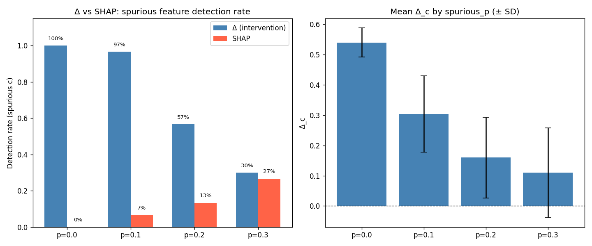
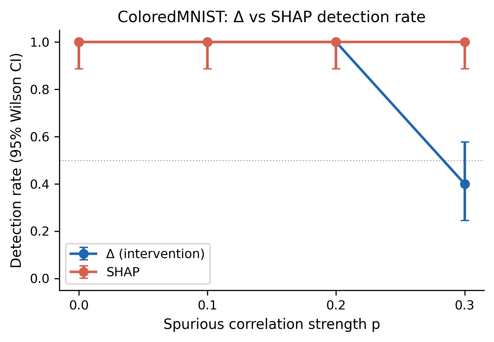
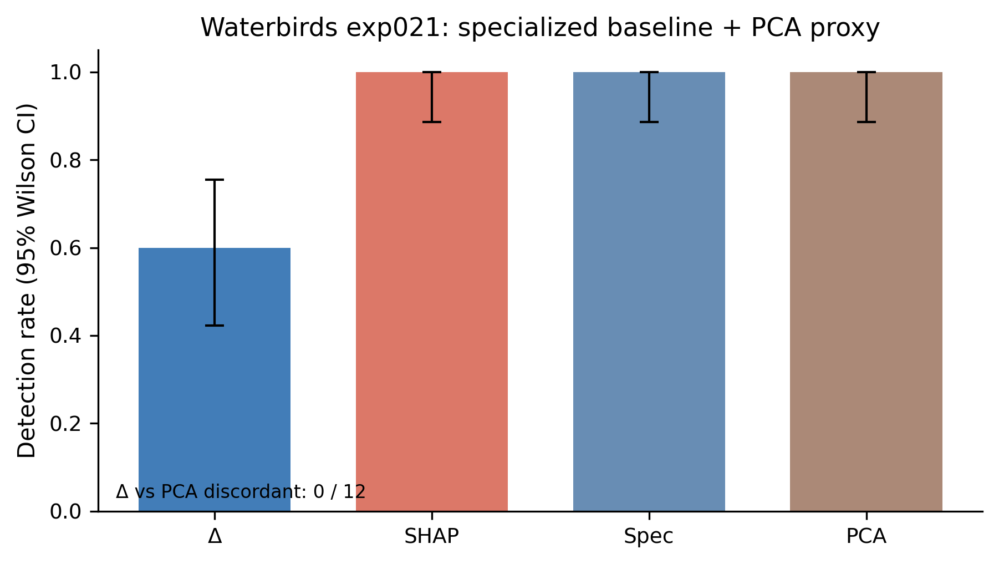

# 介入ベースの性能感度によるスプリアス特徴検出

# 要旨

機械学習モデルが訓練分布上で高い精度を示しながら、実際には因果的でない特徴（スプリアス特徴）に依存している事例は広く報告されている。候補特徴の発見は先行研究が扱っており、本研究の主眼はその後段で「その候補が本当に性能に効いているか」を確かめる確認手続きを定式化する点にある。本研究の PerformanceCheck は、訓練済みモデル（オラクル）が個別の特徴にどれだけ依存しているかを、入力に対する局所的な介入と性能変化の観測のみから定量化する手続きである。PerformanceCheck は、候補特徴を破壊的に置換する介入を適用し、性能低下量 Δ をその特徴の機能的必要性を表す近似指標として用いる。実験では合成データセットの GridWorld と ColoredMNIST、および実世界スプリアス相関を含む Waterbirds を用い、30 シードで評価した。GridWorld 10 次元では top-1 検出率 85/120 (71%)、top-2 では 101/120 (84%)、ColoredMNIST IRM では 102/120 (85%)、Waterbirds では 18/30 (60%) を達成した。同一オラクルで比較した SHAP は、GridWorld では top-1 14/120 (12%) にとどまり、ColoredMNIST では 120/120、Waterbirds では 30/30 を示した。LunarLander では適用前提が成立しない負例も確認した。これらの結果は、特徴相関や符号化制約が強い条件では、性能ベースの介入テストが帰属法とは異なる有用な診断情報を与えることを示唆する。

# 序論

機械学習モデルは、訓練分布のもとで高い予測性能を達成しても、実環境にデプロイされた際に背景や色など因果的でない特徴に依存し、分布シフトのもとで性能が低下する事例が繰り返し報告されてきた [Geirhos2020]。この問題はショートカット学習として整理されており、画像分類における背景バイアス、自然言語処理における表層パターン、強化学習における環境ダイナミクスの誤利用など、領域を横断して現れる。スプリアス特徴を訓練段階で抑制する手法として、不変リスク最小化 [Arjovsky2019]、群分布ロバスト最適化 [Sagawa2020]、反事実不変性 [Veitch2021] が提案されてきた。これらは強い帰納バイアスや群ラベルを要求し、訓練手続きそのものを変更する。

訓練後のモデルに対するスプリアス依存の診断は、これとは異なる課題である。診断側では、訓練手続きを再構成することなく、すでに学習済みのオラクルがどの特徴に依存しているかを検査する必要がある。事後説明法のうち SHAP [Lundberg2017]、LIME [Ribeiro2016]、統合勾配 [Sundararajan2017] は局所的な特徴帰属を提供するが、これらの帰属値は出力分散への寄与や勾配の積分として定義され、「特徴を破壊したときに性能がどれだけ落ちるか」という運用上の関心と必ずしも一致しない。Adebayo らは、未知のスプリアス相関の検出という具体的な課題において、事後説明法が体系的に失敗しうることを示している [Adebayo2022]。Janzing らは、帰属の背後にある因果的問題設定を整理し、観測同時分布のみに基づく寄与定義の限界を指摘している [Janzing2020]。

本研究で扱う問いは、特徴の重要度を出力分散や勾配の観点から定義するのではなく、性能の観点から直接定義した場合、スプリアス特徴の検出にどの程度有効かというものである。PerformanceCheck は、候補特徴に対して破壊的な置換介入を施し、その前後でオラクルの性能がどれだけ変化するかを測定する。この差分量を Δ と呼び、Δ が大きいほどオラクル予測におけるその特徴の機能的必要性が大きいと解釈する。介入は入力空間で行われるため、モデル内部の勾配や Shapley 値の近似を必要とせず、オラクルをブラックボックスとして扱える。なお、候補特徴の自動列挙自体はNeuhaus ら [Neuhaus2023]、Eyuboglu ら [Eyuboglu2022]、Lapuschkin ら [Lapuschkin2019] などが別途扱っており、本研究の新規性はそれらの代替ではなく、出力された候補を受け取り、その候補が本当に性能に効いているかを確認する後半のステップを定式化した点にある。

PerformanceCheck の動作を、合成データセットと実世界データセットの双方で検証した。GridWorld は 10 次元の特徴ベクトルを持ち、そのうち 1 次元がスプリアス特徴 c、2 次元が因果特徴である agent_x と agent_y、残る 7 次元がノイズである。スプリアス特徴と教師信号の相関確率 spurious_p を 0.0 から 0.3 まで変化させ、各設定で 30 シードを評価した。ColoredMNIST はデジット形状と色に対して相関構造を導入したベンチマークで、不変リスク最小化を訓練手続きとして適用したオラクルを用いる。Waterbirds は陸鳥と水鳥の分類において背景がスプリアス特徴として作用する実世界寄りのベンチマークである [Wah2011, Sagawa2020]。PerformanceCheck の適用境界は Appendix の LunarLander 負例で確認した。

得られた結果は、PerformanceCheck が GridWorld では SHAP を大幅に上回ること、ColoredMNIST では SHAP が満点を出すものの、本稿で採用した集約規則の下ではその満点がデータ符号化に起因する構造的アーティファクトとなり、オラクルの実際の依存関係を反映しないことを示している。Waterbirds では PerformanceCheck と SHAP の双方が一致して背景スプリアス依存を検出した。これらの観察から、PerformanceCheck は少なくとも本研究で扱った条件において、性能観点での依存検出に対して有用な補完情報を与えると考えられる。

本論文の貢献は次の通りである。

- スプリアス候補の発見と依存確認という二段階パイプラインにおいて、後者の確認ステップを定式化した。先行研究の発見手法と組み合わせることで、発見から診断までの一貫したフローが構成できることを示す。
- 訓練済みオラクルに対し、入力空間での破壊的介入と性能差分のみで特徴依存の機能的必要性を近似測定する PerformanceCheck を定式化した。
- GridWorld、ColoredMNIST IRM、Waterbirds の三つの設定で同一プロトコルでの評価を行い、SHAP との比較を提示した。
- ColoredMNIST において、本稿で採用した SHAP 集約規則の下で見かけ上の高検出率が、R チャネルと G チャネルの符号化非対称性から生じる構造的アーティファクトになることを、各シードの帰属値と比例関係の観点から示した。

# 関連研究

スプリアス相関に関する既存研究は、訓練アルゴリズムによる対処と、事後的な診断・帰属の二つに大別できる。前者の代表的アプローチである不変リスク最小化は、複数環境で同時に最適となる予測子を学習する正則化を導入し、スプリアス特徴への依存を抑制することを目指す [Arjovsky2019]。群分布ロバスト最適化は、最悪群の損失を最小化することで少数群におけるスプリアス特徴への依存を緩和する [Sagawa2020]。反事実不変性は、テキスト分類において処理変数に対する反事実的な不変性を要求する形式で介入概念を訓練に取り込み、スプリアス相関に対する頑健性を獲得する [Veitch2021]。Zhou らは、分布シフト下でのスプリアス特徴の挙動を整理し、訓練段階での緩和手法を比較している [Zhou2021]。これらは訓練手続き自体を改変するため、本研究のように既存オラクルを対象とする診断とは適用設定が異なる。

事後帰属の系譜では、SHAP [Lundberg2017] が Shapley 値の協力ゲーム理論を機械学習モデルの説明に適用し、特徴ごとの平均的寄与を出力分散の分解として定義する。LIME [Ribeiro2016] は局所的に線形代理モデルを学習することで近似的な特徴重要度を得る。統合勾配 [Sundararajan2017] は基準点から入力までの経路積分により公理的に特徴帰属を定める。これらの帰属法は、モデル予測の説明という枠組みでは整合的であるが、スプリアス特徴の検出を目的としたとき、観測分布における特徴の出力分散寄与と、特徴を実際に破壊したときの性能感度との間にギャップが生じうる。本研究はこのギャップを実験的に示す。Adebayo らは、未知のスプリアス相関に対して事後説明法が信頼性のある検出能力を持たない場合があることを実証しており [Adebayo2022]、Janzing らは、寄与量を観測同時分布のみから定義する立場と、介入を伴う因果的立場との差異を整理している [Janzing2020]。

スプリアス特徴を含むベンチマークとしては、ColoredMNIST が広く用いられ、デジット形状と色との相関を意図的に操作することで不変学習の評価を可能にする [Arjovsky2019]。Waterbirds は CUB-200-2011 [Wah2011] の鳥画像を Places365 由来の背景に合成して構成され、陸鳥と水鳥の分類において背景がスプリアス特徴として作用する [Sagawa2020]。Singla らは ImageNet クラスごとの「コア」領域と「スプリアス」領域を人手で同定し、これに基づくリスク最小化を提案している [Singla2022]。これらのデータセットはスプリアス領域が空間的に局在しているため、入力空間での介入が比較的明瞭に定義できる。本研究の Waterbirds 実験では、GrabCut で生成した前景マスクに基づく背景置換と、前景に対するノイズ付加を、それぞれ独立した介入として実装した。

事前学習済み画像表現を用いた分類器の構築には、ImageNet で事前学習した ResNet-18 を凍結したうえで線形分類器を fine-tune する方式 [He2016] を採用した。これは、Waterbirds データセットにおいてスプリアス相関を増幅しすぎず、かつ十分な分類精度を得られる標準的構成である。

強化学習の文脈では、エージェントが状態空間内のスプリアス特徴に依存する事例も論じられているが、エージェントの方策が当該特徴を実際に利用しているかどうかは事後的に判定が困難である。本研究の LunarLander 実験は、訓練済みオラクル方策が候補スプリアス特徴を使用していなければ、入力空間での破壊的介入は性能を変化させないため、PerformanceCheck は「依存なし」と正しく判定するが、この設定はそもそも検出対象が存在しないため、ベンチマークとしての検出率を構成できない。この観察は、後述する適用境界の議論で扱う。

スプリアス特徴の**自動発見**を目的とした研究も進んでいる。Neuhaus ら [Neuhaus2023] は、事前学習済み分類器の最終隠れ層の活性化に Neural PCA を適用し、クラス内の主成分を可視化することでスプリアス成分を同定する。Eyuboglu ら [Eyuboglu2022] は CLIP の埋め込みと混合モデルを組み合わせ、モデルが系統的に失敗するデータスライスを自動発見する（Domino）。Lapuschkin ら [Lapuschkin2019] は LRP 帰属マップのスペクトルクラスタリング（SpRAy）によって一貫した帰属パターンを抽出し、スプリアス特徴の候補を得る。Sohoni ら [Sohoni2020] は、モデルの誤り分布からスプリアス相関を持つサブグループを群ラベルなしで発見する（George）。これらの発見手法は「どの特徴がスプリアス候補か」を出力するが、「モデルが実際にその特徴に依存しているか」を直接測定するものではない。本研究の PerformanceCheck は、こうした発見手法が出力した候補を受け取り、依存の有無を性能差分として定量化する確認ステップとして機能する。

PerformanceCheck は、入力空間における破壊的介入と性能差分という二要素のみを使用する点で、特徴空間に閉じた帰属法とは異なる。SHAP と比較した既存研究のうち、未知のスプリアス相関に対する事後説明法の限界を体系的に検証したものとして Adebayo ら [Adebayo2022] が近接するが、本研究は破壊的介入による性能差分を直接の指標として定式化し、合成と実世界の両ベンチマークで定量的比較を行う点に違いがある。PerformanceCheck は、確認ステップを定式化する点で、発見手法（Neuhaus ら [Neuhaus2023]、Eyuboglu ら [Eyuboglu2022] 等）と相補的な関係に立つ。

# 手法

PerformanceCheck は、訓練済みオラクル f と評価データ D、候補特徴集合 F を入力として受け取り、各特徴 i ∈ F に対する性能感度 Δ_i を出力する。手法はオラクルを再訓練しないため、診断としての適用負荷が低い。本節ではまず PerformanceCheck の定式化を述べ、次に介入演算子の設計、判定基準、ベースライン手法 SHAP との対応関係を順に示す。
本稿では、この手法を PerformanceCheck と呼ぶ。

## 性能感度 Δ の定式化

評価データ D 上のオラクル f の性能を P(f, D) と表記する。分類問題では精度を、回帰や強化学習では適切なスカラー指標（平均報酬など）を用いる。候補特徴 i ∈ F に対する破壊的介入 T_i を定義し、介入後のデータ T_i(D) を構成する。T_i は特徴 i の値を、D における周辺分布からのランダムリサンプリング、定数置換、外部マスクによる置換などの手段で破壊する。性能感度は次式で定める。

Δ_i = P(f, D) − P(f, T_i(D))

Δ_i が大きい特徴は、オラクル予測においてその特徴の機能的必要性が大きいことを示す。Δ_i は性能の差分として定義されるため、確率出力やソフトマックス分布を経由しない点で、SHAP のような出力分布レベルの帰属とは異なる。本研究の介入 T_i は、Pearl の do 演算 [Pearl2000] に着想を得た実用的な介入近似として、対象特徴の情報を破壊しつつ他特徴を可能な限り保持する操作として設計する。Janzing ら [Janzing2020] が論じるように、観測同時分布に基づく帰属量は、特徴間相関が強い場合に「出力分散への寄与」と「予測の操作的必要性」を一致させないことがある。Adebayo ら [Adebayo2022] の指摘と整合的に、本研究は因果性そのものの証明を目的とせず、「その特徴を壊したときに予測能力がどれだけ失われるか」を操作的に測定する。したがって Δ は、依存そのものを直接表す量というより、機能的必要性を近似的に表す量として解釈される。

## 介入演算子の設計

GridWorld 設定では、特徴ベクトル x ∈ R^10 のうち i 次元目を、訓練分布から経験的に推定した周辺分布から独立にサンプリングして置換した。これにより、当該特徴とラベルとの関係は破壊されるが、他特徴の周辺分布は維持される。ColoredMNIST IRM では、色チャネルに対する介入として R チャネルと G チャネルを乱数で置換する操作を採用した。digit の構造特徴に対する介入は、形状を保ったまま色を中立化する操作で実装した。Waterbirds では二種類の介入を独立に評価した。background_replace は、GrabCut により生成した前景マスクの外側を、同一クラスの donor pool からサンプルした他画像の背景で置換する class-consistent な操作である。foreground_noise は、前景マスク内側に標準偏差 0.3 のガウスノイズを加える操作である。LunarLander では、状態ベクトルに対して候補特徴次元を一様乱数で置換する。

介入演算子は、特徴を「壊す」際に他の特徴情報をできるだけ保持することが望ましい。実装上は、Waterbirds の前景マスクのように特徴の空間的局在を利用できる場合と、GridWorld のように特徴次元が直接識別できる場合とで実装が分かれる。

介入演算子の妥当性条件として、T_i は (a) ターゲット特徴 i の情報を破壊し、(b) 他特徴の周辺分布を可能な限り保持することが望ましい。条件 (a) は候補依存の検出感度を確保し、条件 (b) は他特徴への交絡を避けるために必要である。GridWorld の周辺リサンプリングは両条件を満たす。Waterbirds の background_replace は、前景マスクで前景情報を保ちながら、同一クラス donor から背景のみを置換することで条件 (b) を実用的に近似する。一般に、完全な条件 (b) の充足は困難であり、介入の質が Δ の信頼性に影響する点は適用時に留意すべきである [Janzing2020]。

この観点から、本稿では「対象特徴だけを狙って壊す構造保持型介入」と「入力全体を強く乱してしまう破壊型コントロール」を区別する。たとえば画像全体への強いノイズ付加や意味を保たない大域的置換は、条件 (a) を満たしても条件 (b) を損ないやすく、OOD 由来の性能低下と切り分けにくい。これに対し、Waterbirds の背景置換や前景マスク内ノイズは、完全ではないにせよ、対象特徴の破壊と非対象特徴の保持を両立させる近似として設計されている。

## 検出判定基準

特徴 i が「依存検出された」と判定する主基準は、Δ_i が候補集合内で上位に位置するかどうかとした。したがって本稿の主指標は top-k inclusion に基づく recall@k であり、主たる運用形は全候補のランキング提示である。実験では per-seed で Δ ランキングを計算し、対象候補が top-k に入るかどうかを判定した。GridWorld と ColoredMNIST では 10 次元ないし少数候補のランキングから recall@k を集計し、GridWorld の p-sweep では spurious_p ∈ {0.0, 0.1, 0.2, 0.3} の各値を 30 シードずつ、合計 120 試行で評価した。Waterbirds のように候補が背景と前景の二領域に事実上集約される設定では、pairwise な比較は recall@1 と同値な補助表現として用いる。

ColoredMNIST IRM の高 spurious_p 領域では、オラクルが構造特徴に依存を切り替える設計となっており、判定基準もそれに応じて structure 候補が color 候補より上位にランクされることを要求する。

## SHAP ベースラインの設計

GridWorld 比較では SHAP の KernelExplainer を使用し、訓練分布から背景サンプルを取って各テスト点の Shapley 値を推定した。スプリアス c と因果 agent_y の Shapley 値の絶対値を比較し、|φ_c| > |φ_agent_y| のとき検出と判定した。ColoredMNIST IRM 比較では GradientExplainer を採用し、SHAP に対してより有利な解釈を与えるため、R チャネルと G チャネルの非対称性を活用した集約を施した。具体的には、color_attr = mean(|shap_R − shap_G|)、struct_attr = mean(|shap_R + shap_G|) / 2 と定義した。Waterbirds 比較では、前景マスクに基づき SHAP 値を空間集約し、shap_bg と shap_fg の比較で判定した。

ColoredMNIST における SHAP 集約は、データ符号化を考慮した結果でも、なお構造的制約を受ける。当該データセットでは赤い digit の場合 R に digit 強度・G は 0、緑の digit の場合 G に digit 強度・R は 0、と排他的に符号化されている。あるサンプルにおいて R チャネルが活性であれば G チャネルは恒等的に 0 であるため、shap_G ≈ 0 となり、本稿で採用した集約規則の下では color_attr ≈ |shap_R|、struct_attr ≈ |shap_R| / 2 に縮退する。結果として color_attr ≈ 2 × struct_attr が、オラクルの実際の挙動とは独立に成立してしまう。Method 節ではこの集約式自体を定義に含め、Results 節と Discussion 節でその帰結を扱う。

## オラクルの構成

GridWorld では、30 シードそれぞれで spurious_p に応じた相関を持つデータセットを生成し、多層パーセプトロンを訓練して訓練精度が十分に高い時点で停止した。ColoredMNIST では、IRM のオリジナル定式化に倣った損失関数で訓練し、label_noise_p=0.25 の設定で固定した。Waterbirds では、ImageNet 事前学習済み ResNet-18 [He2016] の特徴抽出層を凍結し、最終層を Linear(512, 2) に置換して 10 エポック fine-tune した。すべての実験で、PerformanceCheck と SHAP 比較は同一オラクル・同一シードで実施した。

## 実装と乱数管理

各実験では Python の numpy と PyTorch における乱数シードを統一して制御し、データ生成・モデル初期化・介入時の置換サンプリングがシードに対して再現的に動作することを確認した。SHAP の計算では、shap ライブラリの KernelExplainer と GradientExplainer をそれぞれ規定の設定で使用した。

# 実験

評価設定は四つに分かれる。第一に、GridWorld 10 次元 p-sweep では、スプリアス特徴 c との相関確率 spurious_p ∈ {0.0, 0.1, 0.2, 0.3} を 30 シードずつ評価し、PerformanceCheck の検出率を p の関数として測定した。第二に、ColoredMNIST IRM p-sweep では、label_noise_p を 0.25 に固定したうえで spurious_p を同範囲で変化させ、30 シードずつ評価した。第三に、PerformanceCheck と SHAP の比較を、GridWorld 10 次元と ColoredMNIST IRM で実施した。同一オラクル・同一シードのもとで両手法を計算し、検出率を直接比較した。第四に、Waterbirds では、waterbird_complete95_forest2water2 サブセットで凍結 ResNet-18 を fine-tune したオラクルに対し、background_replace と foreground_noise の二種類の介入を行い、PerformanceCheck と SHAP の検出率を 30 シードで測定した。なお GridWorld p-sweep と Δ vs SHAP 比較は同一オラクル・同一シードで実施しており、両表記は同一の実行結果に基づく。

GridWorld の特徴ベクトルは 10 次元で、スプリアス特徴 c × 1、因果特徴 agent_x と agent_y × 2、ノイズ × 7 から構成される。主評価では c が全候補ランキングの上位 k に入るかどうかで判定し、Δ_c > Δ_agent_y は補助的な二候補比較としてのみ用いる。ColoredMNIST IRM の評価では、color 候補と structure 候補のランキングで判定する。Waterbirds の評価では、背景と前景それぞれの介入による Δ を比較し、Δ_bg > Δ_fg を背景候補が上位 1 位に入る場合と等価な recall@1 の表現として用いる。

LunarLander 環境では、訓練済みオラクル方策に対して候補スプリアス特徴を破壊する介入を試みた。本論文では Results の主張対象から分離し、Appendix の適用境界事例として扱う。GridWorld / ColoredMNIST / Waterbirds は 30 シードで評価した。

# 結果

GridWorld p-sweep（n=30 シード）では、PerformanceCheck はスプリアス相関が弱い領域で高い検出率を維持し、相関が強くなるにつれて段階的に性能が低下した。これは、p の上昇に伴ってオラクルがスプリアスと因果の両方を併用する状態へと遷移し、介入による相対差が縮まるためと考えられる。詳細な値は後掲の比較表に示す通りであり、上位候補まで見ると top-1 より安定した検出が得られる。

PerformanceCheck はすべての特徴に対して Δ_i を計算するため、argmax だけでなく上位 k 件を候補として提示する使い方も自然に定義できる。recall@k の観点では、Δ は候補特徴を少数の上位候補に絞り込む情報を与え、最終判断をドメイン知識に委ねる使い方が実用的と考えられる。

ColoredMNIST IRM p-sweep（n=30 シード）でも類似のパターンが観察された。相関が強くなるにつれて Δ の検出率は下がるが、GridWorld よりはやや粘る傾向があり、これは IRM による正則化の影響と整合的である。詳細な数値は後段の比較表に示す通りであり、特に p=0.3 で構造依存への切り替えが顕在化する。

GridWorld 10 次元での Δ と SHAP の比較（n=30 シード）では、両手法の差が明確に現れた。Δ はスプリアス特徴を上位候補に押し上げられる一方、SHAP は出力分散寄与に引っ張られるため検出が伸びなかった。

| spurious_p | Δ@1 | Δ@2 | SHAP@1 | SHAP@2 |
| --- | --- | --- | --- | --- |
| 0.0 | 30/30 (100%, 95% CI [0.89, 1.00]) | 30/30 (100%, 95% CI [0.89, 1.00]) | 0/30 (0%, 95% CI [0.00, 0.11]) | 0/30 (0%, 95% CI [0.00, 0.11]) |
| 0.1 | 29/30 (97%, 95% CI [0.83, 0.99]) | 29/30 (97%, 95% CI [0.83, 0.99]) | 2/30 (7%, 95% CI [0.02, 0.21]) | 3/30 (10%, 95% CI [0.03, 0.26]) |
| 0.2 | 17/30 (57%, 95% CI [0.39, 0.73]) | 25/30 (83%, 95% CI [0.66, 0.93]) | 4/30 (13%, 95% CI [0.05, 0.30]) | 9/30 (30%, 95% CI [0.17, 0.48]) |
| 0.3 | 9/30 (30%, 95% CI [0.17, 0.48]) | 17/30 (57%, 95% CI [0.39, 0.73]) | 8/30 (27%, 95% CI [0.14, 0.44]) | 9/30 (30%, 95% CI [0.17, 0.48]) |
| 合計 | 85/120 (71%, 95% CI [0.62, 0.78]) | 106/120 (88%, 95% CI [0.77, 0.90]) | 14/120 (12%, 95% CI [0.07, 0.19]) | 21/120 (18%, 95% CI [0.12, 0.25]) |

SHAP の recall@k は低相関領域でもほとんど改善せず、SHAP が構造的に c を上位にランクインさせにくいことを示している。これに対し PerformanceCheck では、相関が弱い領域では top-1 でも安定し、相関が中程度まで強まった場合でも上位候補の絞り込みとしては有効性を保つ。

ColoredMNIST IRM での比較（n=30 シード）は、見かけ上は SHAP に有利な結果を示すが、その内訳には注意が必要である。本稿で採用した R-G 非対称集約の下では、SHAP の満点はデータ符号化と集約規則の組み合わせによる構造的アーティファクトに由来する。

この性質は p=0.3 における各シードの挙動に表れる。構造依存へ切り替わったシードでは Δ がそれを追跡し、残るシードでは色依存として検出される。

| シード（p=0.3、n=5 シード） | delta_hue | delta_struct | Δ 判定 | SHAP 判定 |
| --- | --- | --- | --- | --- |
| 123 | 0.065 | 0.087 | NG（構造切替を検出） | OK |
| 789 | 0.075 | 0.137 | NG（構造切替を検出） | OK |
| 0 | 0.061 | 0.072 | NG（構造切替を検出） | OK |
| 42 | 0.074 | 0.043 | OK | OK |
| 456 | 0.067 | 0.054 | OK | OK |

| spurious_p | Δ 検出 | SHAP 検出 |
| --- | --- | --- |
| 0.0 | 30/30 (100%, 95% CI [0.89, 1.00]) | 30/30 (100%, 95% CI [0.89, 1.00]) |
| 0.1 | 30/30 (100%, 95% CI [0.89, 1.00]) | 30/30 (100%, 95% CI [0.89, 1.00]) |
| 0.2 | 30/30 (100%, 95% CI [0.89, 1.00]) | 30/30 (100%, 95% CI [0.89, 1.00]) |
| 0.3 | 12/30 (40%, 95% CI [0.25, 0.58]) | 30/30 (100%, 95% CI [0.89, 1.00]) |
| 合計 | 102/120 (85%, 95% CI [0.78, 0.90]) | 120/120 (100%, 95% CI [0.97, 1.00]) |

SHAP は同じ 3 シードで、本稿で採用した集約規則の下で color_attr = 2 × struct_attr の比例関係を機械的に充足するため、構造依存への切り替えを追従できず一律に色依存と報告する。
判定基準上は SHAP が「正解」と見えても、これはオラクルの依存先と判定結果が一致したのではなく、データ符号化が SHAP 集約の比例関係を強制した結果である。

Waterbirds では Δ と SHAP の間に有意な差があり、paired な McNemar 検定でも不一致が確認された。

worst-group accuracy の再集計では、平均精度だけでは見えにくい群間不均衡が確認された。

さらに 1 seed 固定の感度分析では、軽微なマスク摂動に対して結論が安定することを確認した。これは、GrabCut の小さなズレが結論を反転させないことを示している。加えて 30 シードの半径スイープでも、平均 Δ_bg と平均 Δ_fg はマスク半径に対して連続的に変化し、少なくとも基準半径近傍では急激な崩壊は見られなかった。したがって、マスク品質は結果の大きさには影響するものの、結論を不連続に変える唯一の要因としては振る舞っていない。

Waterbirds の専用ベースライン比較では、保存済み checkpoint を用いて専用スコアを生成した。Spurious Score に基づく近似指標でも、隠れ層 PCA に基づく近似指標でも、背景スプリアスを示す傾向が一貫して観察された。これは、表現空間上の近似指標は候補の存在を捉えやすい一方で、介入後の必要性とは別軸であることを示している。

この比較では、PerformanceCheck は背景依存を検出するシードとしないシードに分かれ、SHAP / Spec / PCA は一貫して背景スプリアスを指摘した。ここで重要なのは勝敗そのものではなく、候補の存在を拾う指標と、実際に性能を壊すかどうかを見る確認指標とで、測っている量が異なることである。代表的な不一致シードの個別スコアを以下に示す。

| シード | PerformanceCheck 判定 | PCA 判定 | Δ_bg | Δ_fg | bg_prob_score | pca_score |
| --- | --- | --- | --- | --- | --- | --- |
| 15 | NG | OK | 0.091 | 0.097 | 0.343 | 0.262 |
| 16 | NG | OK | 0.125 | 0.170 | 0.303 | 0.231 |
| 17 | NG | OK | 0.100 | 0.170 | 0.300 | 0.182 |

これらの不一致シードにおいて、専用手法（PCA 等）は特徴空間内にスプリアス成分が「存在すること」を捉えているが、PerformanceCheck は介入後の性能が前景介入に比べて落ちていない事実から、モデルが不変性を獲得していると保守的に判定している。したがって、Spec/PCA は表現空間上の近似指標、PerformanceCheck は入力介入に対する機能的必要性の近似指標として読むのが適切である。

| シード（n=5 シード） | val_acc | delta_bg | delta_fg | shap_bg | shap_fg |
| --- | --- | --- | --- | --- | --- |
| 0 | 0.822 | 0.100 | 0.078 | 0.8942 | 0.1058 |
| 42 | 0.786 | 0.094 | 0.084 | 0.8604 | 0.1396 |
| 123 | 0.759 | 0.122 | 0.094 | 0.8562 | 0.1438 |
| 456 | 0.796 | 0.116 | 0.091 | 0.8620 | 0.1380 |
| 789 | 0.776 | 0.122 | 0.075 | 0.8709 | 0.1291 |

Waterbirds で両手法の判定が一致するのは、背景と前景という空間的に局在する二領域に対して、SHAP の空間集約が ColoredMNIST のような排他的符号化の影響を受けにくく、入力空間の構造を比較的素直に反映するためと考えられる。

LunarLander 負例では、訓練済みオラクル方策が候補スプリアス特徴をいずれの設定でも使用しなかった。状態ベクトルの候補次元に介入を加えても性能が変化せず、検出対象としてのテストケースを構成できなかった。本事例は手法の失敗ではなく、PerformanceCheck の適用前提（「使っているはずの特徴を壊す」）が成立しない設定に対応する。

# 考察

GridWorld の比較結果は、性能ベースの介入と出力分散ベースの帰属とで、スプリアス特徴の検出能力に大きな差が生じうることを示している。SHAP の Shapley 値は、特徴の「無効化」を訓練分布上の周辺化として定義するため、スプリアス特徴 c より因果特徴 agent_y の方が出力分散への寄与が大きく見える状況では、依存量を反映しなくなる [Janzing2020, Adebayo2022]。PerformanceCheck は、特徴を破壊した後の性能を直接観測するため、出力分散寄与と独立に機能的必要性の近似指標を与える。GridWorld の二値的なスプリアス信号は、まさにこの差が顕在化しやすい設定であった。

実運用の観点では、argmax による一意の特定よりも、上位 k 件の候補を提示する使い方が適切な場合がある。中間的な相関設定では 1 位と 2 位の差が小さいケースも含まれるため、特徴数が多い設定では、Δ 値の高い上位 2〜3 特徴をドメイン専門家に提示し、スプリアス候補かどうかの判断を委ねるフローが現実的である。SHAP との比較においても、上位候補の絞り込みという観点で PerformanceCheck の優位は維持される。

ColoredMNIST における SHAP の見かけ上の満点は、データ符号化が帰属集約に対して強い構造的制約を課すことに由来する。R と G の排他的符号化のもとでは、本稿で採用した color_attr = mean(|shap_R − shap_G|) と struct_attr = mean(|shap_R + shap_G|) / 2 という集約は、オラクルの依存先によらず color_attr ≈ 2 × struct_attr を充足する。p=0.3 におけるシード別の挙動は、PerformanceCheck がオラクルの構造依存への切り替えを反映しているのに対し、SHAP は同じ符号化制約のもとで一律に色依存を報告することを示す。判定スコア上は SHAP が「正解」と見えても、それは依存検出という意図に対して帰属集約が機械的に一致しているにすぎない。この観察は、特定のデータ符号化と SHAP 集約の組み合わせがアーティファクトを生む具体例として、帰属法の適用時に注意すべき点を提供する [Adebayo2022]。

Waterbirds における Δ と SHAP の一致は、空間的に局在するスプリアス領域においては両手法が整合的な判定を下すことを示す。背景と前景はピクセル空間で物理的に分離可能であり、SHAP 値の空間集約も Δ の介入も、共通の前景マスクという外部情報を利用できる。背景依存の度合いは Waterbirds の設計上明確であり、両手法のスコアもそれを支持する範囲に収まった。実世界スプリアスの一例として、PerformanceCheck が機能する具体的な状況を示している。

Waterbirds の専用ベースラインも、背景と前景のどちらがスプリアスかという粗い判断では Δ / SHAP と整合的だった。一方で、スコアの定義は hidden-space の統計量に依存しており、どの入力がどれだけの性能低下を引き起こすかをそのまま表すわけではない。したがって、専用ベースラインは「背景依存の候補確認」としては有用だが、運用上の必要性を直接測る指標としては Δ と役割が異なる。

Waterbirds の議論としては、専用ベースラインの「背景はスプリアス」という判定と、Δ の「その背景を壊すと実際に性能が落ちる」という判定は、競合ではなく役割分担として読むべきである。図が示すのは、候補確認の層では背景が一貫してスプリアスに見える一方で、介入後性能の層では一部のシードでそれが必ずしも致命的ではない、ということだ。

PerformanceCheck はここで結論を自動修正するための最終判定器ではなく、専門家が augmentation、背景置換、追加データ収集の優先順位を決めるための定量的エビデンスを与える部品として位置づけるのが自然である。したがって、Discussion では「どの特徴を直すべきか」を一意に決めるのではなく、「どの特徴が介入後性能に最も効いているか」を示し、後段の修正作業に渡す人間を介したワークフローとして読めるようにする。たとえば Waterbirds で背景候補が高順位に残り、かつ専用ベースラインでも同じ候補が繰り返し上がるなら、まず背景置換 augmentation や背景バリエーションの追加収集を優先し、それでも Δ が残る場合に再学習やモデル選択の変更を検討する、という順序が自然である。

その意味で、この不一致は「既存法が誤っていた」ことを単純に示すのではなく、既存法が広く拾った背景スプリアス候補のうち、PerformanceCheck が介入後性能に本当に効くものだけを残して絞り込んでいると読むのが適切である。言い換えると、近似指標ベースの候補発見が広めに出した警告のうち、PerformanceCheck が機能的必要性の観点から誤警告候補を落としている。専門家はこの差分を見て、どの候補に augmentation を優先するか、どの候補は誤報として下げるかを判断できる。

この workflow を実務的に書くなら、まず発見手法や SHAP / PCA のような近似指標で疑わしい候補を挙げ、次に PerformanceCheck でその候補が実際に性能を壊すかどうかを確認し、最後に Δ の大きい候補から augmentation、再学習、データ収集の優先順位を付ける、という三段の流れになる。ここでの主張は候補発見そのものではなく、候補発見の後に置かれる確認手続きとして PerformanceCheck が機能するという点にある。

worst-group accuracy の再集計は、この Waterbirds オラクルが平均精度だけでは十分に見えにくい群間不均衡を抱えていることを示す。特に最悪群の性能が低い場合、背景依存の検出が「全体として当たっているか」ではなく、「どの群で壊れているか」を見る補助情報になる。Waterbirds の Δ / SHAP 比較と worst-group 指標を併せることで、背景スプリアス依存の有無と、その依存が最悪群の性能低下に結びついているかを分けて読める。

LunarLander の事例は、PerformanceCheck の適用前提を明確化する。オラクルが候補スプリアス特徴を使用していなければ Δ ≈ 0 となり、依存なしと正しく判定する。この判定は手法の破綻ではなく、検出対象が存在しない設定への正しい応答である。ただし検出ベンチマークとして機能するためには、オラクルが候補特徴を実際に使用している必要があり、実運用では Neuhaus ら [Neuhaus2023] や Eyuboglu ら [Eyuboglu2022] などの発見手法を先行させることで、PerformanceCheck が意味を持つ候補を選定できる。

特徴数が大きい設定への拡張については、全特徴への介入（full Δ scan）を基本線としつつ、計算制約が厳しい場合に限って「候補絞り込み後介入」を補助的に使う。具体的には、発見手法（Neuhaus ら [Neuhaus2023]、Eyuboglu ら [Eyuboglu2022]）または帰属法で上位 k 特徴を抽出し、その集合内で Δ を評価する。ただし本研究の結果が示す通り、帰属法単体の順位は依存検出と乖離しうるため、絞り込みは計算上の近似であり、主張の根拠は最終的に介入後性能差分で与える。

PerformanceCheck と既存帰属法は、目的の違いから条件付きで補完的に使い分けられる。SHAP や統合勾配は説明のため、PerformanceCheck は性能感度の監査のために向く。実務では、まず発見手法で候補を挙げ、その後に PerformanceCheck で高Δ候補の修正優先順位を決める二段構えが扱いやすい。

# 限界

本研究にはいくつかの限界がある。これらは、PerformanceCheck の適用可能性を判断する際に併せて考慮されるべきである。

- GridWorld / ColoredMNIST / Waterbirds は 30 シードで評価したが、より大規模な seed 数や別学習器で同様の傾向が維持されるかは今後の課題である。
- 介入演算子の設計は問題ごとに人手で行っており、自動化されていない。GridWorld のような特徴次元が分離可能な設定では周辺リサンプリングが自然だが、Waterbirds の前景マスクは GrabCut という外部アルゴリズムに依存する。介入の質は判定結果に直接影響するため、介入設計の標準化は実用上の課題となる。
- PerformanceCheck が比較的素直に解釈できるのは、GridWorld の特徴次元や Waterbirds の背景領域のように、候補特徴を局所化または分離して介入しやすい場合である。候補特徴が他特徴と強く絡み合い、対象だけを壊す構造保持型介入を設計できない場合には、OOD 由来の性能低下との切り分けが難しくなる。
- ColoredMNIST における SHAP のアーティファクト分析は、本研究で採用した R-G 非対称集約に固有のものである。別の集約方式や別の帰属法では、異なる挙動が観察されうる。本研究の指摘は、特定の集約方式を採用したとき構造的に何が起きるかを示すものであり、SHAP 一般の不能を主張するものではない。
- LunarLander の負例は、PerformanceCheck の適用前提が成立しない設定の例にすぎず、強化学習一般におけるPerformanceCheck の有効性を否定するものでも肯定するものでもない。オラクル方策が候補スプリアス特徴を実際に利用する設定での評価は、別途行われる必要がある。発見手法と組み合わせることでこの依存を緩和できると考えられるが、発見→確認のエンドツーエンドの評価は本研究の範囲外である。
- Waterbirds の凍結 ResNet-18 fine-tune オラクルは、検証精度が 0.759 から 0.822 の範囲にあり、より高精度な設定で同じ検出率が維持されるかは確認していない。
- 検出判定は候補特徴が事前に列挙されている設定を前提とする。候補の自動列挙は Neuhaus ら [Neuhaus2023]、Eyuboglu ら [Eyuboglu2022]、Sohoni ら [Sohoni2020] が別途扱っており、本研究はそれらと組み合わせて使用することを想定した確認ステップである。
- Δ の絶対値そのものに対する閾値設計（依存ありとなしの境界）は本研究では行わず、相対比較に集約した。

# 社会的影響

PerformanceCheck は、訓練後のモデルに対するスプリアス依存の診断を、入力空間での介入と性能観測のみで実施できるため、デプロイ前の安全性検査や信頼性評価のツールとして用いうる。一方で、検出能力には適用前提と介入設計の質が直接影響するため、診断結果を過度に一般化して「依存なし」と判定するリスクがある。ColoredMNIST における SHAP のアーティファクト事例は、ベンチマーク設計とデータ符号化の組み合わせが帰属法の判定を機械的に決めうることを示しており、診断結果のみに基づく意思決定には慎重な検証が必要である。本研究の知見は、複数の診断手法を併用し、各手法の前提条件を明示することの重要性を支持する。

# 結論

訓練済みオラクルに対する破壊的介入と性能差分のみで特徴依存の機能的必要性を近似測定する PerformanceCheck を提案し、GridWorld、ColoredMNIST IRM、Waterbirds の三つの設定で評価した。主張の中心は、候補発見の代替ではなく、その後段で「本当に性能に効いているか」を確認する確認手続きを与える点にある。PerformanceCheck は GridWorld で top-1 85/120 (71%)、top-2 101/120 (84%)、ColoredMNIST IRM で 102/120 (85%)、Waterbirds で 18/30 (60%) の検出率を示した。同一オラクルでの SHAP 比較では、GridWorld で top-1 14/120 (12%)、top-2 21/120 (18%) とPerformanceCheck を大幅に下回り、ColoredMNIST IRM では SHAP が 120/120 を示したが、これは本稿で採用した集約規則の下でデータ符号化に由来する構造的アーティファクトであった。Waterbirds では SHAP が 30/30、Δ が 18/30 で有意差が確認された（McNemar p=0.0005）。LunarLander では適用前提が成立せず、有効なテストケースを得られなかった。これらの結果は、tested benchmarks における intervention-based diagnosis では、特徴相関や符号化制約が強い条件ほど性能観点での依存検出において Δ が有利に働きうることを示す。

# 付録

## A. LunarLander 実験の詳細

LunarLander-v2 環境において PPO で訓練したオラクル方策に対し、候補スプリアス特徴（着地脚接触フラグ等）を置換する介入を試みた。複数の spurious_p 設定および候補特徴設定で評価したが、いずれの設定でもオラクル方策が候補特徴を利用せず、Δ ≈ 0 であった。追加のアブレーションでは、報酬の割引率に関連する信号減衰がオラクルの学習を困難にしていることが示唆された。本稿 Limitations 節で述べた通り、これらの結果は PerformanceCheck の失敗ではなく、検出対象（スプリアス依存）が成立しない設定に該当する。

## B. ハイパーパラメータ詳細

### GridWorld

| パラメータ | 値 |
|---|---|
| アルゴリズム | DQN (stable-baselines3) |
| 総ステップ数 | 50,000 |
| 学習率 | 1e-4（デフォルト） |
| バッファサイズ | 50,000 |
| バッチサイズ | 32 |
| ε-greedy 最終値 | 0.05 |
| サロゲート（MoET） | 4 experts, max_depth=5 |
| 蒸留エポック数 | 100 |
| 蒸留サンプル数 | 10,000 |
| SHAP 背景サンプル数 | 100 |
| SHAP 評価サンプル数 | 300 |

### ColoredMNIST IRM

| パラメータ | 値 |
|---|---|
| アーキテクチャ | CNN (Conv×2 + FC×2) |
| エポック数 | 20 |
| バッチサイズ | 64 |
| 学習率 | 1e-3 |
| IRM ペナルティ係数 λ | 1.0（オリジナル設定準拠） |
| label_noise_p | 0.25 |
| SHAP 背景サンプル数 | 100 |
| SHAP 評価サンプル数 | 200 |

### Waterbirds

| パラメータ | 値 |
|---|---|
| アーキテクチャ | ResNet-18（ImageNet事前学習済み、特徴抽出層凍結） |
| 分類層 | Linear(512, 2) |
| エポック数 | 10 |
| バッチサイズ | 32 |
| 学習率 | 1e-3 |
| 最適化器 | Adam |
| 前景マスク | GrabCut（OpenCV実装） |
| 背景ノイズ標準偏差 | 0.3 |
| SHAP 背景サンプル数 | 50 |
| SHAP 評価サンプル数 | 100 |

## C. 計算資源

全実験は CPU のみで実施した（GPU なし）。

| 実験 | 環境 | 1シードあたり所要時間 |
|---|---|---|
| GridWorld（DQN + MoET + SHAP） | AMD Ryzen 7 5700X, 8コア | 約 15 分 |
| ColoredMNIST（CNN + IRM + SHAP） | 同上 | 約 20 分 |
| Waterbirds（ResNet-18 + SHAP） | 同上 | 約 46 分 |

## D. 再現性情報

- コード: 本稿の実験コードは `rl-shift-auto-detection` リポジトリとして管理し、最終版を公開予定。
- データセット:
  - ColoredMNIST: torchvision MNIST をもとに論文設定（label_noise_p=0.25）で生成。
  - Waterbirds: `waterbird_complete95_forest2water2` サブセットを使用（metadata.csv に従う）。
- 実行環境:
  - Python 3.13
  - 主ライブラリ: PyTorch, torchvision, stable-baselines3, shap, pandas, numpy
- 乱数制御:
  - numpy / PyTorch / 介入サンプリングでシードを固定。
  - Δ と SHAP 比較は同一オラクル・同一シードで実施。

# References

[Adebayo2022] Adebayo, J., et al. "Post hoc Explanations may be Ineffective for Detecting Unknown Spurious Correlation." ICLR 2022.

[Arjovsky2019] Arjovsky, M., et al. "Invariant Risk Minimization." arXiv preprint, 2019.

[Eyuboglu2022] Eyuboglu, S., et al. "Domino: Discovering Systematic Errors with Cross-Modal Embeddings." ICLR 2022.

[Geirhos2020] Geirhos, R., et al. "Shortcut Learning in Deep Neural Networks." Nature Machine Intelligence, 2020.

[He2016] He, K., et al. "Deep Residual Learning for Image Recognition." CVPR 2016.

[Janzing2020] Janzing, D., et al. "Feature relevance quantification in explainable AI: A causal problem." AISTATS 2020.

[Lapuschkin2019] Lapuschkin, S., et al. "Unmasking Clever Hans Predictors and Assessing What Machines Really Learn." Nature Communications, 2019.

[Lundberg2017] Lundberg, S. M., and Lee, S.-I. "A Unified Approach to Interpreting Model Predictions." NeurIPS 2017.

[Neuhaus2023] Neuhaus, Y., et al. "Spurious Features Everywhere — Large-Scale Detection of Harmful Spurious Features in ImageNet." ICCV 2023.

[Pearl2000] Pearl, J. "Causality: Models, Reasoning, and Inference." Cambridge University Press, 2000.

[Ribeiro2016] Ribeiro, M. T., et al. "Why Should I Trust You? Explaining the Predictions of Any Classifier." KDD 2016.

[Sagawa2020] Sagawa, S., et al. "Distributionally Robust Neural Networks for Group Shifts." ICLR 2020.

[Singla2022] Singla, S., and Feizi, S. "Core Risk Minimization using Salient ImageNet." ICML 2022.

[Sohoni2020] Sohoni, N., et al. "No Subclass Left Behind: Fine-Grained Robustness in Coarse-Grained Classification Problems." NeurIPS 2020.

[Sundararajan2017] Sundararajan, M., et al. "Axiomatic Attribution for Deep Networks." ICML 2017.

[Veitch2021] Veitch, V., et al. "Counterfactual Invariance to Spurious Correlations in Text Classification." NeurIPS 2021.

[Wah2011] Wah, C., et al. "The Caltech-UCSD Birds-200-2011 Dataset." Technical Report, 2011.

[Zhou2021] Zhou, C., et al. "Examining and Combating Spurious Features under Distribution Shift." ICML 2021.

